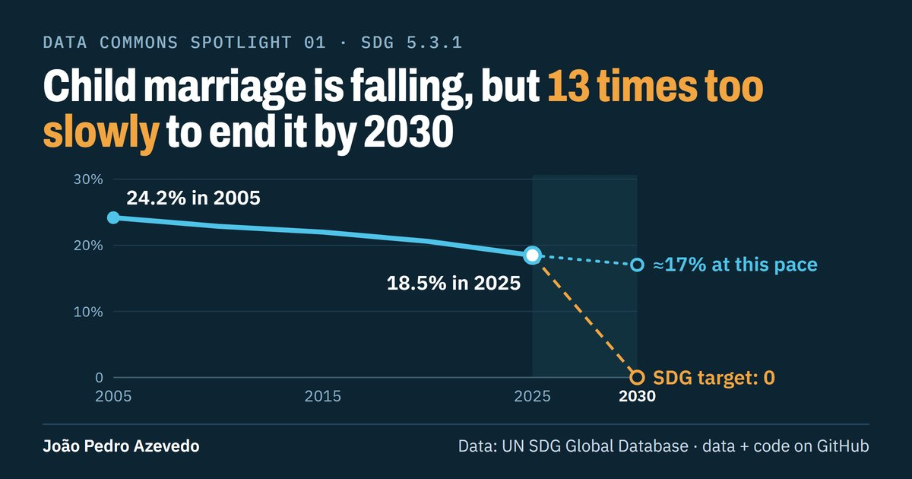
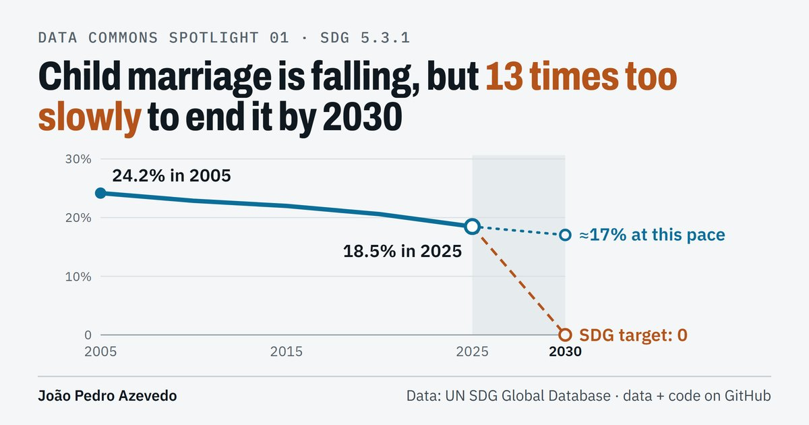

# UN Data Commons Spotlight

A recurring series of banners, each highlighting one statistic on children and women from the
[UN System Data Commons](https://unstats.un.org/sdgs/dataportal). Every number on a banner is
derived from the data committed in this repository, by the scripts committed here.

<!-- spotlights:start -->
| # | Topic | SDG indicator | Data retrieved |
|---|-------|---------------|----------------|
| 01 | [Child marriage](spotlights/01-child-marriage) | 5.3.1 | 2026-10-23 |
| 02 | [Under-five mortality](spotlights/02-under-five-mortality) | 3.2.1 | 2026-10-31 |
| 03 | [Women in parliament](spotlights/03-women-in-parliament) | 5.5.1 | 2026-10-31 |
| 04 | [Maternal mortality](spotlights/04-maternal-mortality) | 3.1.1 | 2026-10-31 |
| 05 | [Safely managed drinking water, LDCs, LLDCs and SIDS compared with the World](spotlights/05-water-ldc-lldc-sids) | 6.1.1 | 2026-11-01 |
| 06 | [Safely managed sanitation, LDCs, LLDCs and SIDS compared with the World](spotlights/06-sanitation-ldc-lldc-sids) | 6.2.1 | 2026-11-01 |
| 07 | [Child marriage before 18, LDCs, LLDCs and SIDS compared with the World, by location](spotlights/07-child-marriage-ldc-lldc-sids) | 5.3.1 | 2026-11-01 |
| 08 | [Child marriage before 15, Landlocked developing countries (LLDCs), by location](spotlights/08-marriage-before-15-lldcs) | 5.3.1 | 2026-11-01 |
| 09 | [Safely managed sanitation, Least developed countries (LDCs), by location](spotlights/09-sanitation-ldcs) | 6.2.1 | 2026-11-01 |
| 10 | [Safely managed drinking water, SDG regions compared](spotlights/10-water-regions) | 6.1.1 | 2026-11-01 |
| 11 | [Pre-primary participation, SDG regions compared, by sex](spotlights/11-pre-primary-regions) | 4.2.2 | 2026-11-01 |
| 12 | [School completion, SDG regions compared, by sex](spotlights/12-primary-completion-regions) | 4.1.2 | 2026-11-01 |
| 13 | [Child marriage before 18, SDG regions compared, by location](spotlights/13-child-marriage-regions) | 5.3.1 | 2026-11-01 |
| 14 | [Child marriage before 15, World](spotlights/14-marriage-before-15-world) | 5.3.1 | 2026-11-01 |
| 15 | [School completion, World, by wealth](spotlights/15-primary-completion-world) | 4.1.2 | 2026-11-01 |
| 16 | [Safely managed drinking water, World](spotlights/16-water-world) | 6.1.1 | 2026-11-01 |
| 17 | [Safely managed sanitation, World](spotlights/17-sanitation-world) | 6.2.1 | 2026-11-01 |
| 18 | [Safely managed sanitation, Northern Africa and Western Asia, by location](spotlights/18-sanitation-n-africa-w-asia) | 6.2.1 | 2026-11-01 |
| 19 | [School completion, Northern Africa and Western Asia, by wealth](spotlights/19-primary-completion-n-africa-w-asia) | 4.1.2 | 2026-11-01 |
| 20 | [Safely managed drinking water, Northern Africa and Western Asia, by location](spotlights/20-water-n-africa-w-asia) | 6.1.1 | 2026-11-01 |
| 21 | [School completion, Eastern and South-eastern Asia, by wealth](spotlights/21-primary-completion-east-se-asia) | 4.1.2 | 2026-11-01 |
| 22 | [Safely managed drinking water, Eastern and South-eastern Asia, by location](spotlights/22-water-east-se-asia) | 6.1.1 | 2026-11-01 |
| 23 | [Family planning demand satisfied (modern methods), LDCs, LLDCs and SIDS compared with the World](spotlights/23-family-planning-ldc-lldc-sids) | 3.7.1 | 2026-11-01 |
| 24 | [Skilled birth attendance, LDCs, LLDCs and SIDS compared with the World, by wealth](spotlights/24-birth-attendance-ldc-lldc-sids) | 3.1.2 | 2026-11-01 |
| 25 | [Anaemia in women 15-49, LDCs, LLDCs and SIDS compared with the World](spotlights/25-anaemia-ldc-lldc-sids) | 2.2.3 | 2026-11-01 |
| 26 | [Child overweight, Small island developing states (SIDS), by location](spotlights/26-child-overweight-sids) | 2.2.2 | 2026-11-01 |
| 27 | [Youth NEET, Small island developing states (SIDS), by location](spotlights/27-youth-neet-sids) | 8.6.1 | 2026-11-01 |
| 28 | [Stunting, Small island developing states (SIDS), by location](spotlights/28-stunting-sids) | 2.2.1 | 2026-11-01 |
| 29 | [Women in local government, Landlocked developing countries (LLDCs)](spotlights/29-women-local-government-lldcs) | 5.5.1 | 2026-11-01 |
| 30 | [DTP3 immunization, SDG regions compared, by wealth](spotlights/30-dtp3-regions) | 3.b.1 | 2026-11-01 |
| 31 | [Child labour, SDG regions compared, by sex](spotlights/31-economic-activity-regions) | 8.7.1 | 2026-11-01 |
| 32 | [MCV2 immunization, SDG regions compared](spotlights/32-mcv2-regions) | 3.b.1 | 2026-11-01 |
| 33 | [PCV3 immunization, SDG regions compared](spotlights/33-pcv3-regions) | 3.b.1 | 2026-11-01 |
| 34 | [Youth NEET, World, by sex](spotlights/34-youth-neet-world) | 8.6.1 | 2026-11-01 |
| 35 | [Child overweight, World, by sex](spotlights/35-child-overweight-world) | 2.2.2 | 2026-11-01 |
| 36 | [Violent discipline, World](spotlights/36-violent-discipline-world) | 16.2.1 | 2026-11-01 |
| 37 | [Child multidimensional poverty, World](spotlights/37-child-poverty-world) | 1.2.2 | 2026-11-01 |
| 38 | [Early childhood development, World](spotlights/38-early-childhood-world) | 4.2.1 | 2026-11-01 |
| 39 | [Women in national parliaments, Latin America and the Caribbean](spotlights/39-women-parliament-latin-america-caribbean) | 5.5.1 | 2026-11-01 |
| 40 | [Adolescent birth rate, Central and Southern Asia, by location](spotlights/40-adolescent-births-central-southern-asia) | 3.7.2 | 2026-11-01 |
<!-- spotlights:end -->

The table is rebuilt from each Spotlight's `meta.json` when content is published (`scripts/build_readme_table.py`).

## Layout

```
spotlights/<NN-slug>/
  data/world.csv              World series as retrieved (dcid, name, year, value)
  data/countries_latest.csv   Latest value per country as retrieved
  meta.json                   SDG series code, dimensions, variable DCID, source/provenance, retrieval date
  retrieval.json              Exact calls and parameters used to pull the data, plus the
                              equivalent UN SDG API query
  data/api_refresh/<date>/    Optional later re-pulls from the SDG API (never replace the snapshot)
  stats.json                  Every derived number on the banner (written by compute_stats.py)
  banner.dc.html              Banner source (design file)
  banner.png / banner.jpg     Rendered banner (2400x1260 / 1200x630)
  captions.md                 LinkedIn and X post text
scripts/
  compute_stats.py            Data -> stats.json
  render_banner.py            banner.dc.html (or any .dc.html design) -> PNG/JPEG
  fetch_sdg_api.py            Re-pull a series from the UN SDG API and compare with the snapshot
  check_sdg_api.py            Same comparison, by script, for CI; writes the survey sources of the named countries
```

## Banner templates

| Dark | Light |
| --- | --- |
|  |  |

Template E (revision 3, a 1200x1200 square whose headline doubles as the legend, subtitle from the indicator's
registry definition, review round 1's header and footer plus CC BY 4.0 and a "Definition: UNICEF Reference
Data Manager" line when the registry is used) is a pilot, not assigned to any experiment: see
`templates/banner-E-light.dc.html`, `templates/banner-E-dark.dc.html` and
[docs/revision-3-2026-11](docs/revision-3-2026-11/RECOMMENDATIONS.md).

Earlier designs and why they were retired: [docs/design-history](docs/design-history/README.md).

## Experiments

Banner style: from Spotlight 02 the banner template is not chosen by hand. It is read from
[`experiments/001-banner-ground/assignment.csv`](experiments/001-banner-ground/assignment.csv), a seeded random
assignment registered before the experiment started. See
[`PREREGISTRATION.md`](experiments/001-banner-ground/PREREGISTRATION.md) for the question, design, outcomes,
power and decision rule, and `analyze.py` for the pre-specified analysis.

## Reproduce a banner

```bash
pip install -r requirements.txt
python -m playwright install chromium
npm install                      # banner fonts (@fontsource packages) into node_modules/

python scripts/compute_stats.py spotlights/01-child-marriage   # re-derives every figure
python scripts/render_banner.py spotlights/01-child-marriage   # re-renders the banner
python scripts/render_banner.py templates/banner-D-dark.dc.html  # any design file: writes banner-D-dark.png/.jpg beside it
```

The renderer loads the families and weights named in the design's `<helmet>` font link from `node_modules/`, and
stops if one is missing, so a render never silently falls back to a system font.

`compute_stats.py` options: `--target-value` and `--target-year` (default 0 by 2030),
`--stale-cutoff` (default 2020; latest estimates in or before this year count as stale),
`--top` (number of countries ranked).

## Data snapshots and refreshes

Source databases are revised over time, so each spotlight keeps the exact data its banner was
built from (`data/*.csv`), together with the indicator code and the calls used to pull it
(`retrieval.json`). These files are never edited after publication.

To check whether the source has changed since a banner was made:

```bash
python scripts/fetch_sdg_api.py spotlights/01-child-marriage
```

This queries the UN SDG Global Database API, for example
`https://unstats.un.org/SDGAPI/v1/sdg/Series/Data?seriesCode=SP_DYN_MRBF18&pageSize=10000`,
filters to the spotlight's dimensions (here Age 20-24, Sex FEMALE), saves the raw response and
tidy CSVs under `data/api_refresh/<today>/`, and prints the World series next to the snapshot.
The API identifies areas by UN M49 code (World = 1) and includes regional aggregates.

## Data and attribution

Data are retrieved from the UN System Data Commons; `meta.json` in each spotlight records the
SDG series code and dimensions, the Data Commons variable (DCID), the provenance and custodian
source, and the retrieval date.
Country values are each country's latest available year, so they are not directly comparable
across countries. Please cite the original custodian source shown on each banner.

## Licence and citation

Code: MIT. Banners, captions and text: CC BY 4.0. Data: the custodian sources' terms (see each Spotlight's
`meta.json`). How to cite: [`CITATION.cff`](CITATION.cff). Each published Spotlight has a tag, `spotlight-NN`.
