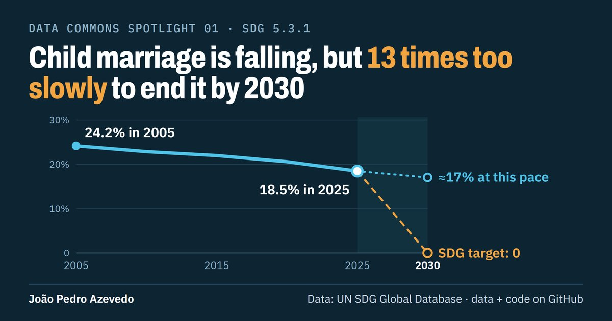
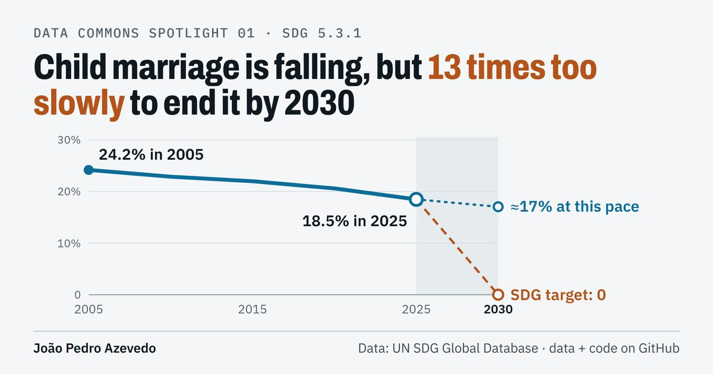
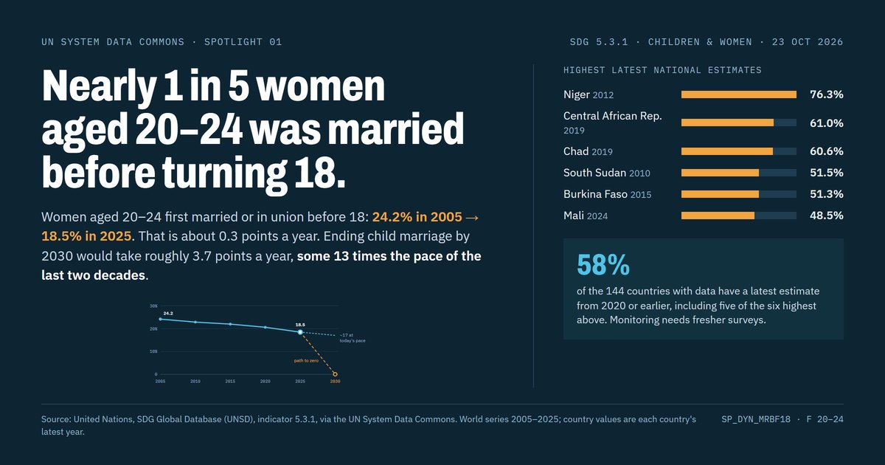
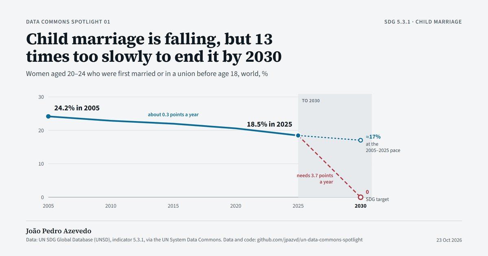
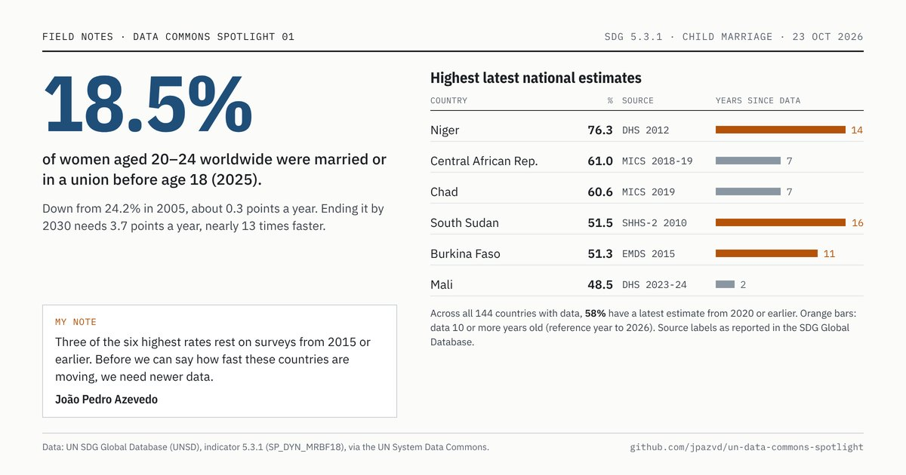

# Banner design history

How the Spotlight banner got to its current form. Every image is rendered from the `.dc.html` file beside it
with `python scripts/render_banner.py <file>` (design A is Spotlight 01's own banner, so it is shown from
[`spotlights/01-child-marriage`](../../spotlights/01-child-marriage) rather than copied here).

## Current: template D, the experiment arms (from Spotlight 02)

One headline sentence, one annotated chart, a byline strip; about 50 words including axis labels; smallest text
20 px at 1200 px wide, so everything stays readable when a phone shrinks the image to about 400 px.
The two arms differ only in the palette; which one a Spotlight gets is drawn at random
([experiment 001](../../experiments/001-banner-ground/PREREGISTRATION.md)).

| Dark | Light |
| --- | --- |
|  |  |

## Retired (23 October 2026)

| Design | Why it was retired |
| --- | --- |
|  **A · dark dashboard** (used for Spotlight 01) | About 175 words; at phone width only the headline stays readable, the rest shrinks to 4–7 px. |
|  **B · editorial, chart-first** | Right structure (finding + one chart), but the chart labels and source shrink below legibility. Template D keeps its structure; whether its light or dark ground works better in the feed is the question experiment 001 tests. |
|  **C · field notes** | The survey-source table and signed note are the most distinctive content, but at phone size only "18.5%" survives, without its meaning. That detail now goes in the captions. |
