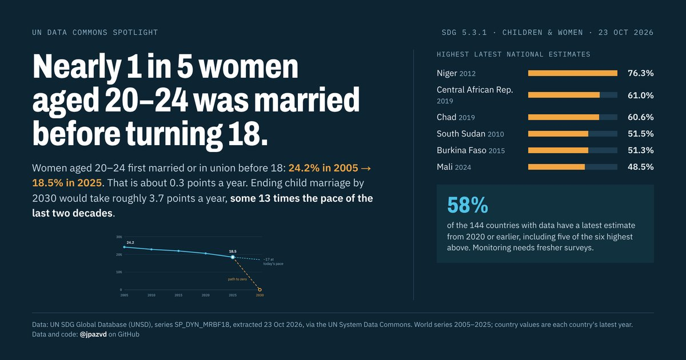

# Spotlight 01 · Child marriage

<!-- Written by scripts/build_spotlight_readmes.py from the files in this folder; do not edit. -->

SDG 5.3.1 · series SP_DYN_MRBF18 · data retrieved 2026-10-23

Design: design A.

**Nearly 1 in 5 women aged 20–24 was married before turning 18.**

[Post text and comments](captions.md) · [Every number](stats.json) · [Design source](banner.dc.html) · [Full-size banner](banner.png)

## Data and calls

- [data/countries_latest.csv](data/countries_latest.csv)
- [data/top_country_sources_sdgapi.csv](data/top_country_sources_sdgapi.csv)
- [data/world.csv](data/world.csv)
- [meta.json](meta.json)
- [retrieval.json](retrieval.json)
- [stats.json](stats.json)

Every number re-derives from these files: `python scripts/reproduce.py spotlights/01-child-marriage`
