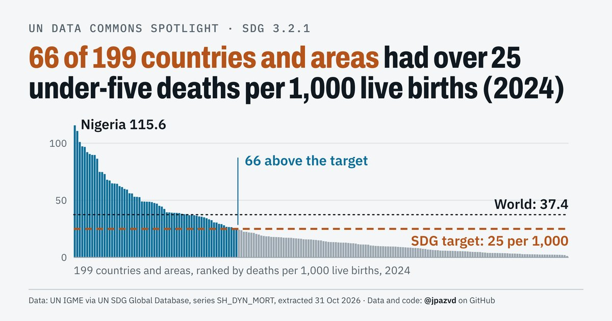

# Spotlight 02 · Under-five mortality

<!-- Written by scripts/build_spotlight_readmes.py from the files in this folder; do not edit. -->

SDG 3.2.1 · series SH_DYN_MORT · data retrieved 2026-10-31

Design: template D light.

**66 of 199 countries and areas had over 25 under-five deaths per 1,000 live births (2024)**

[Post text and comments](captions.md) · [Every number](stats.json) · [Design source](banner.dc.html) · [Full-size banner](banner.png)

## Data and calls

- [data/countries_latest.csv](data/countries_latest.csv)
- [data/top_country_sources_sdgapi.csv](data/top_country_sources_sdgapi.csv)
- [data/world.csv](data/world.csv)
- [meta.json](meta.json)
- [retrieval.json](retrieval.json)
- [stats.json](stats.json)

Every number re-derives from these files: `python scripts/reproduce.py spotlights/02-under-five-mortality`
