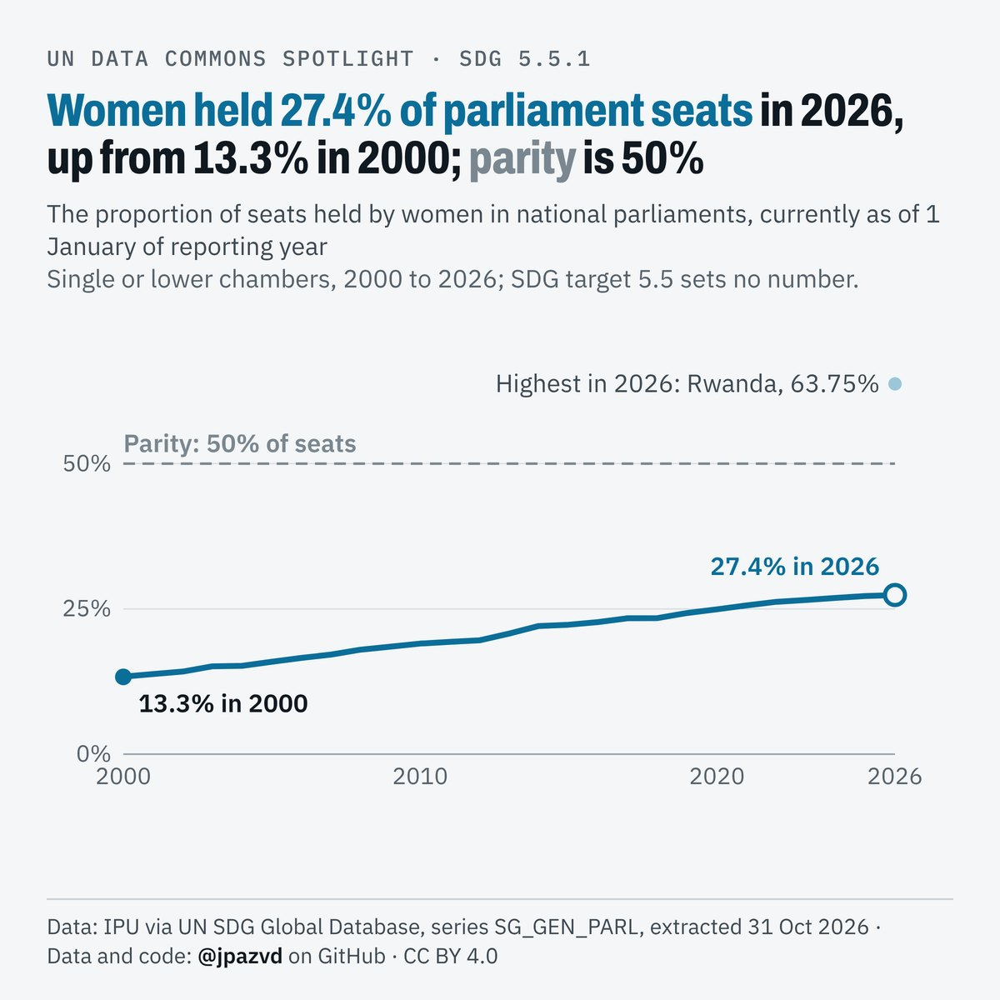

# Spotlight 03 · Women in parliament

<!-- Written by scripts/build_spotlight_readmes.py from the files in this folder; do not edit. -->

SDG 5.5.1 · series SG_GEN_PARL · data retrieved 2026-10-31

Design: template E light.

**Women held 27.4% of parliament seats in 2026, up from 13.3% in 2000; parity is 50%**

[Post text and comments](captions.md) · [Every number](stats.json) · [Alt text](alt.txt) · [Design source](banner.dc.html) · [Full-size banner](banner.png)

## Data and calls

- [data/countries_latest.csv](data/countries_latest.csv)
- [data/top_country_sources_sdgapi.csv](data/top_country_sources_sdgapi.csv)
- [data/world.csv](data/world.csv)
- [meta.json](meta.json)
- [retrieval.json](retrieval.json)
- [stats.json](stats.json)

Every number re-derives from these files: `python scripts/reproduce.py spotlights/03-women-in-parliament`
