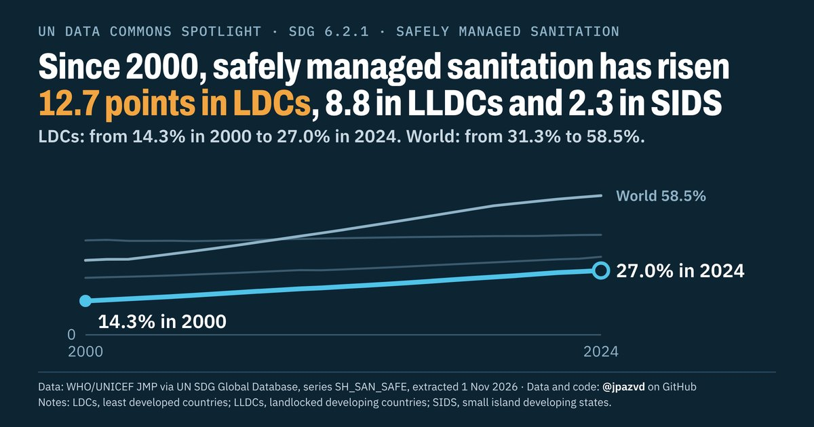

# Spotlight 06-L · Safely managed sanitation, LDCs, LLDCs and SIDS compared with the World

<!-- Written by scripts/build_spotlight_readmes.py from the files in this folder; do not edit. -->

The long view · template D dark · [all versions of this topic](../../)

**Since 2000, safely managed sanitation has risen 12.7 points in LDCs, 8.8 in LLDCs and 2.3 in SIDS**

[Post text and comments](captions.md) · [Every number](stats.json) · [Alt text](alt.txt) · [Design source](banner.dc.html) · [Full-size banner](banner.png)
