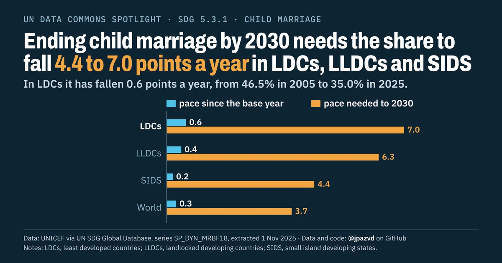
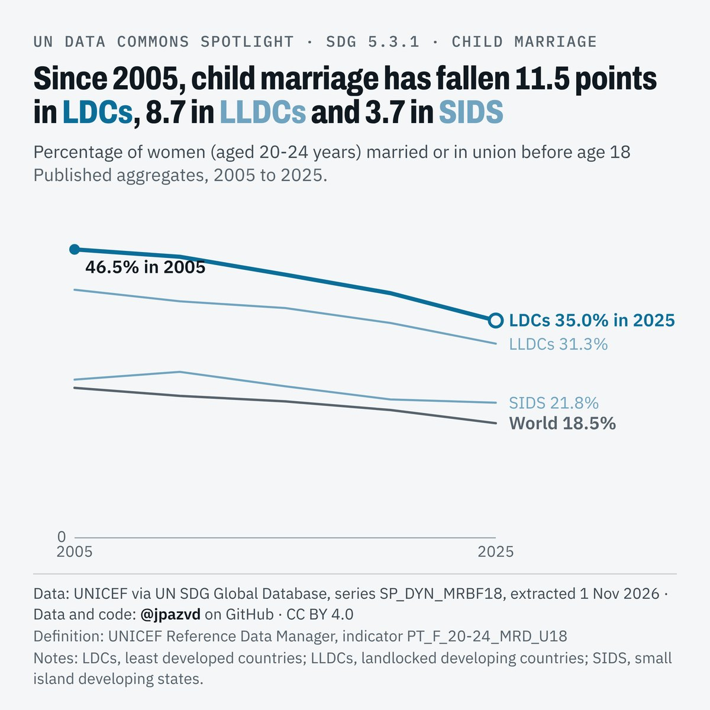
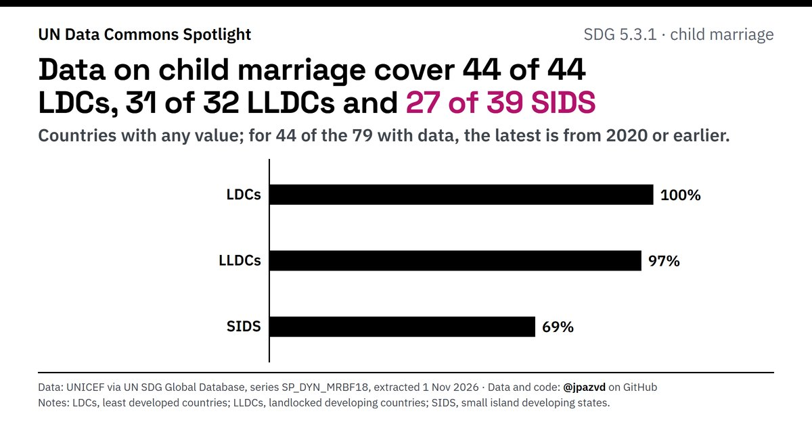

# Spotlight 07 · Child marriage before 18, LDCs, LLDCs and SIDS compared with the World, by location

<!-- Written by scripts/build_spotlight_readmes.py from the files in this folder; do not edit. -->

SDG 5.3.1 · data retrieved 2026-11-01

3 versions of this topic, each with its own headline framing and banner design.

## T · what it would take · template D dark

**Ending child marriage by 2030 needs the share to fall 4.4 to 7.0 points a year in LDCs, LLDCs and SIDS**

[Post text and comments](versions/T/captions.md) · [Every number](versions/T/stats.json) · [Alt text](versions/T/alt.txt) · [Design source](versions/T/banner.dc.html) · [Full-size banner](versions/T/banner.png)

## L · the long view · template E light

**Since 2005, child marriage has fallen 11.5 points in LDCs, 8.7 in LLDCs and 3.7 in SIDS**

[Post text and comments](versions/L/captions.md) · [Every number](versions/L/stats.json) · [Alt text](versions/L/alt.txt) · [Design source](versions/L/banner.dc.html) · [Full-size banner](versions/L/banner.png)

## D · the data behind it · template E dark

**Data on child marriage cover 44 of 44 LDCs, 31 of 32 LLDCs and 27 of 39 SIDS**

[Post text and comments](versions/D/captions.md) · [Every number](versions/D/stats.json) · [Alt text](versions/D/alt.txt) · [Design source](versions/D/banner.dc.html) · [Full-size banner](versions/D/banner.png)

## Data and calls

- [data/breakdown_aggregates.csv](data/breakdown_aggregates.csv)
- [data/breakdown_countries.csv](data/breakdown_countries.csv)
- [data/countries_latest.csv](data/countries_latest.csv)
- [data/membership.csv](data/membership.csv)
- [data/place_series.csv](data/place_series.csv)
- [data/world.csv](data/world.csv)
- [meta.json](meta.json)
- [retrieval.json](retrieval.json)

Every number re-derives from these files: `python scripts/reproduce.py spotlights/07-child-marriage-ldc-lldc-sids`
