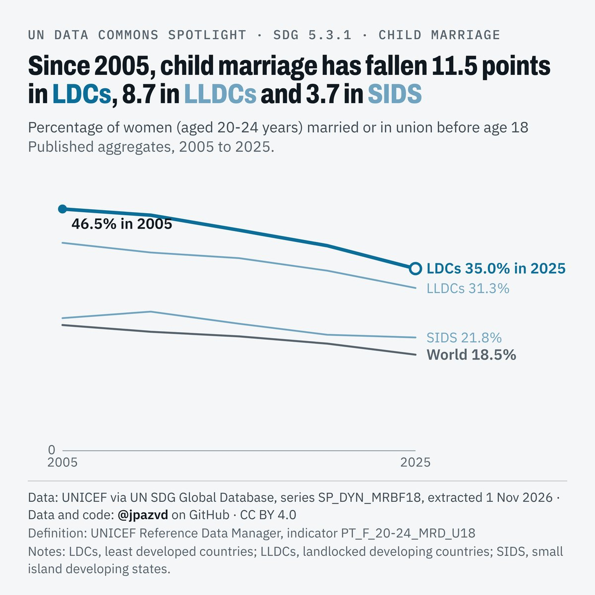

# Spotlight 07-L · Child marriage before 18, LDCs, LLDCs and SIDS compared with the World, by location

<!-- Written by scripts/build_spotlight_readmes.py from the files in this folder; do not edit. -->

The long view · template E light · [all versions of this topic](../../)

**Since 2005, child marriage has fallen 11.5 points in LDCs, 8.7 in LLDCs and 3.7 in SIDS**

[Post text and comments](captions.md) · [Every number](stats.json) · [Alt text](alt.txt) · [Design source](banner.dc.html) · [Full-size banner](banner.png)
