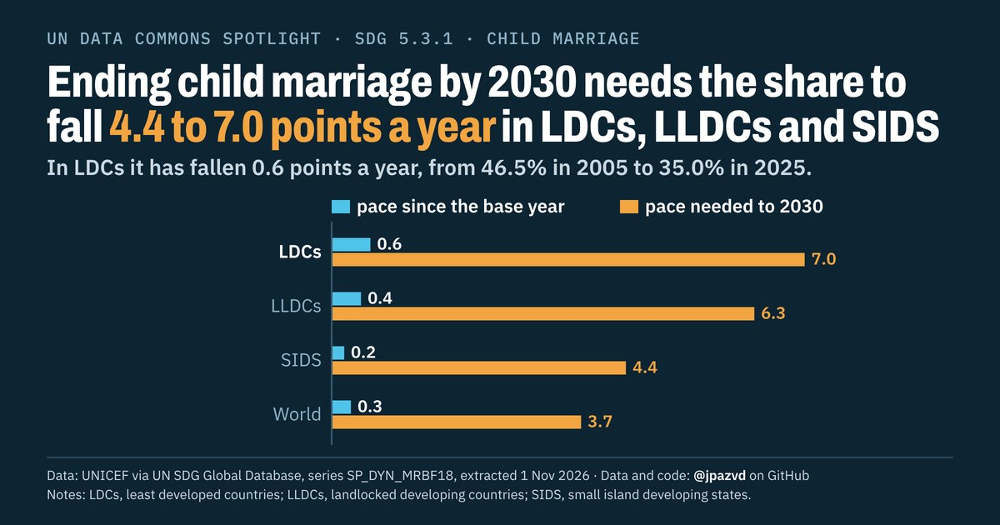

# Spotlight 07-T · Child marriage before 18, LDCs, LLDCs and SIDS compared with the World, by location

<!-- Written by scripts/build_spotlight_readmes.py from the files in this folder; do not edit. -->

What it would take · template D dark · [all versions of this topic](../../)

**Ending child marriage by 2030 needs the share to fall 4.4 to 7.0 points a year in LDCs, LLDCs and SIDS**

[Post text and comments](captions.md) · [Every number](stats.json) · [Alt text](alt.txt) · [Design source](banner.dc.html) · [Full-size banner](banner.png)
