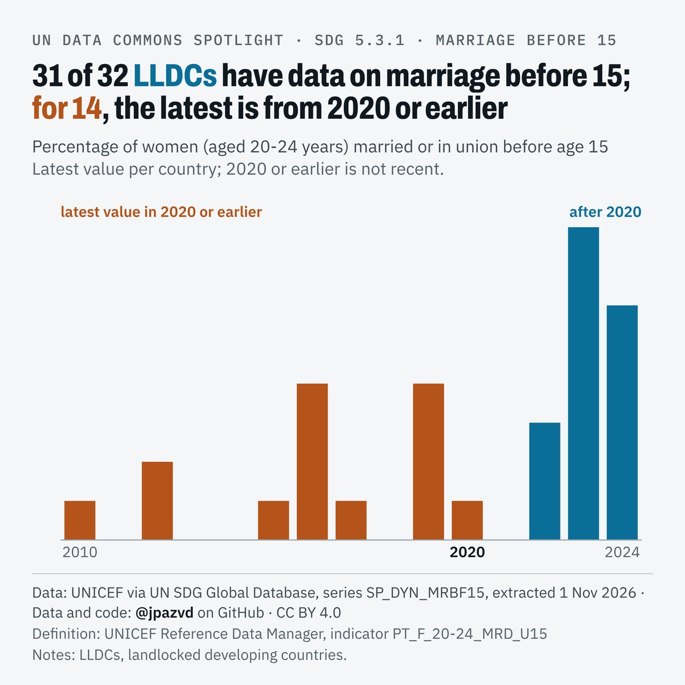

# Spotlight 08-D · Child marriage before 15, Landlocked developing countries (LLDCs), by location

<!-- Written by scripts/build_spotlight_readmes.py from the files in this folder; do not edit. -->

The data behind it · template E light · [all versions of this topic](../../)

**31 of 32 LLDCs have data on marriage before 15; for 14, the latest is from 2020 or earlier**

[Post text and comments](captions.md) · [Every number](stats.json) · [Alt text](alt.txt) · [Design source](banner.dc.html) · [Full-size banner](banner.png)
