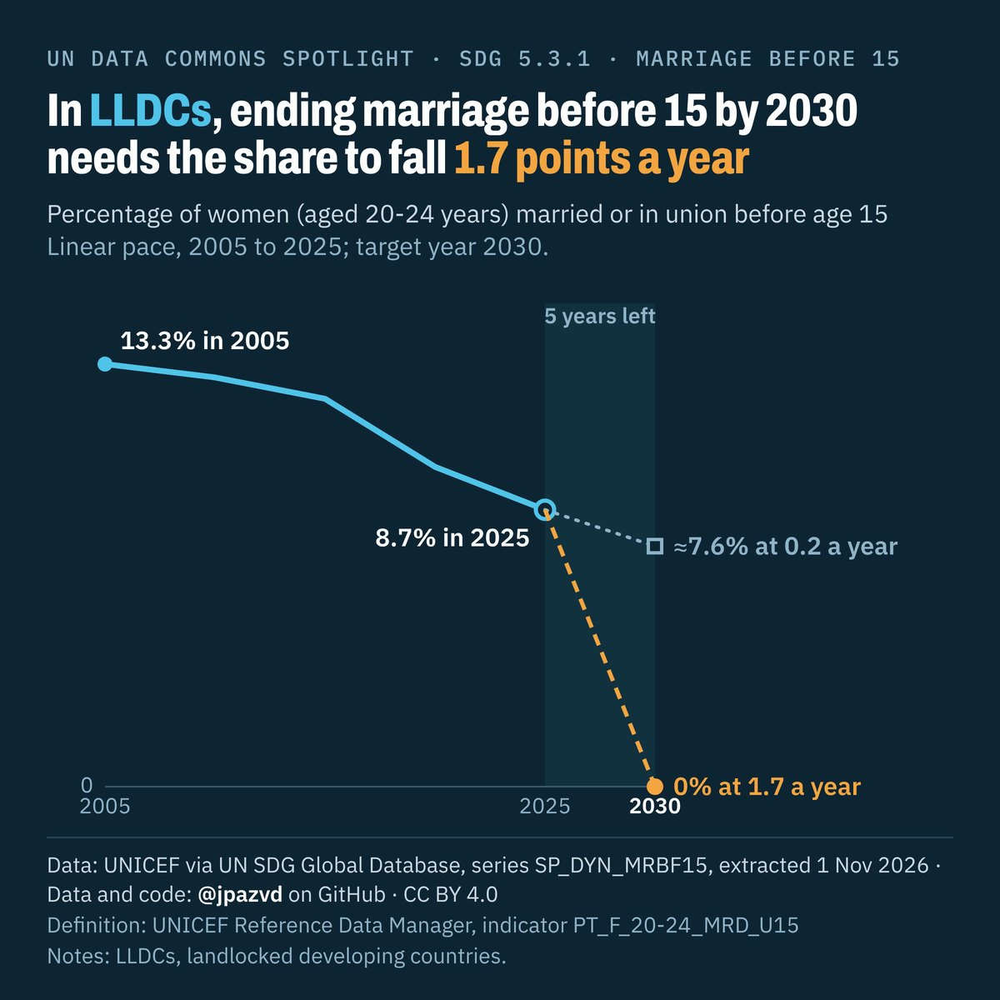

# Spotlight 08-T · Child marriage before 15, Landlocked developing countries (LLDCs), by location

<!-- Written by scripts/build_spotlight_readmes.py from the files in this folder; do not edit. -->

What it would take · template E dark · [all versions of this topic](../../)

**In LLDCs, ending marriage before 15 by 2030 needs the share to fall 1.7 points a year**

[Post text and comments](captions.md) · [Every number](stats.json) · [Alt text](alt.txt) · [Design source](banner.dc.html) · [Full-size banner](banner.png)
