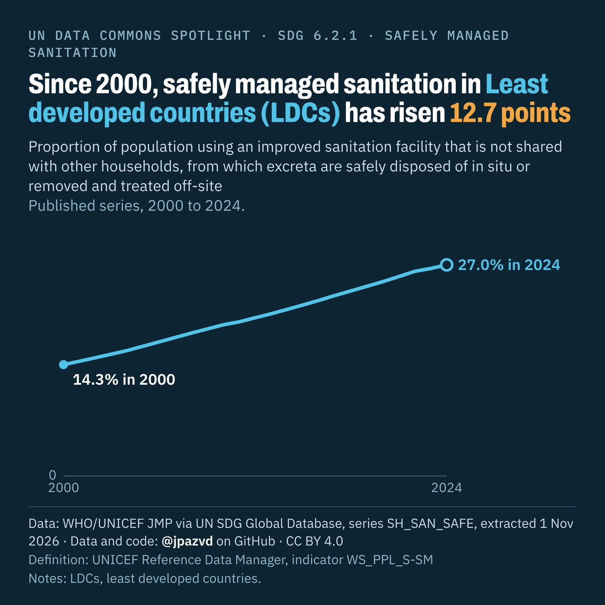

# Spotlight 09-L · Safely managed sanitation, Least developed countries (LDCs), by location

<!-- Written by scripts/build_spotlight_readmes.py from the files in this folder; do not edit. -->

The long view · template E dark · [all versions of this topic](../../)

**Since 2000, safely managed sanitation in Least developed countries (LDCs) has risen 12.7 points**

[Post text and comments](captions.md) · [Every number](stats.json) · [Alt text](alt.txt) · [Design source](banner.dc.html) · [Full-size banner](banner.png)
