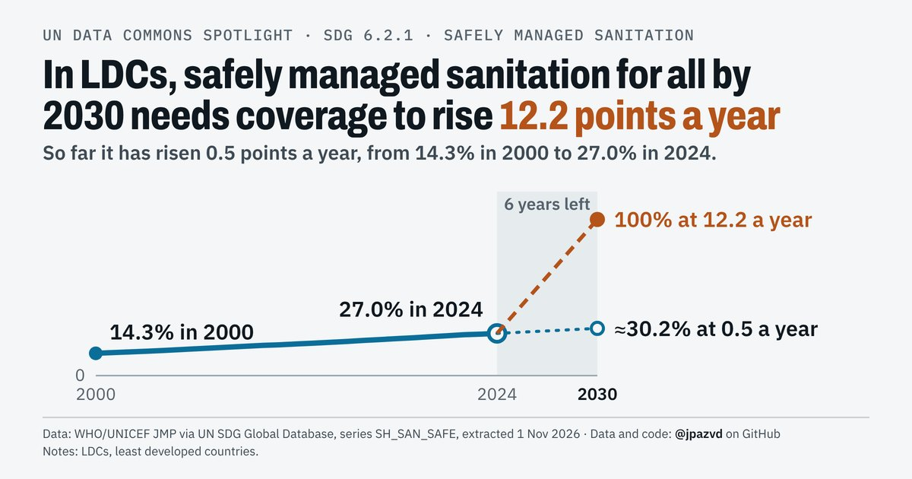

# Spotlight 09-T · Safely managed sanitation, Least developed countries (LDCs), by location

<!-- Written by scripts/build_spotlight_readmes.py from the files in this folder; do not edit. -->

What it would take · template E light · [all versions of this topic](../../)

**In LDCs, safely managed sanitation for all by 2030 needs coverage to rise 12.2 points a year**

[Post text and comments](captions.md) · [Every number](stats.json) · [Alt text](alt.txt) · [Design source](banner.dc.html) · [Full-size banner](banner.png)
