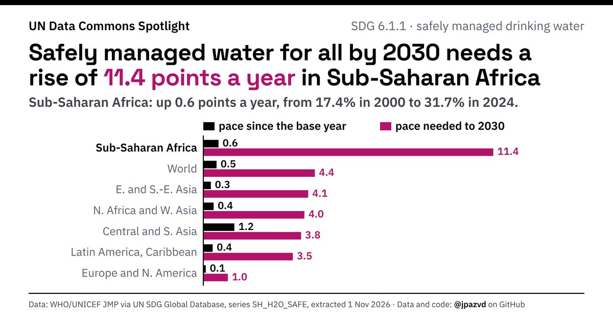

# Spotlight 10-T · Safely managed drinking water, SDG regions compared

<!-- Written by scripts/build_spotlight_readmes.py from the files in this folder; do not edit. -->

What it would take · template E dark · [all versions of this topic](../../)

**Safely managed water for all by 2030 needs a rise of 11.4 points a year in Sub-Saharan Africa**

[Post text and comments](captions.md) · [Every number](stats.json) · [Alt text](alt.txt) · [Design source](banner.dc.html) · [Full-size banner](banner.png)
