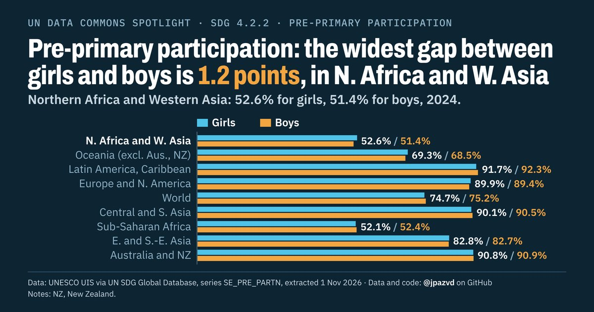

# Spotlight 11-G · Pre-primary participation, SDG regions compared, by sex

<!-- Written by scripts/build_spotlight_readmes.py from the files in this folder; do not edit. -->

Behind the average · template D dark · [all versions of this topic](../../)

**Pre-primary participation: the widest gap between girls and boys is 1.2 points, in N. Africa and W. Asia**

[Post text and comments](captions.md) · [Every number](stats.json) · [Alt text](alt.txt) · [Design source](banner.dc.html) · [Full-size banner](banner.png)
