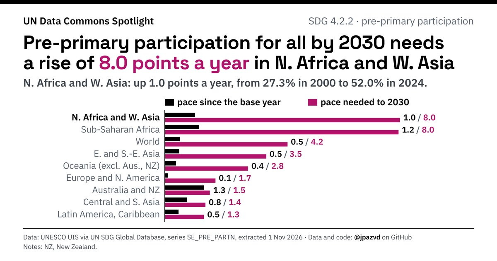

# Spotlight 11-T · Pre-primary participation, SDG regions compared, by sex

<!-- Written by scripts/build_spotlight_readmes.py from the files in this folder; do not edit. -->

What it would take · template E dark · [all versions of this topic](../../)

**Pre-primary participation for all by 2030 needs a rise of 8.0 points a year in N. Africa and W. Asia**

[Post text and comments](captions.md) · [Every number](stats.json) · [Alt text](alt.txt) · [Design source](banner.dc.html) · [Full-size banner](banner.png)
