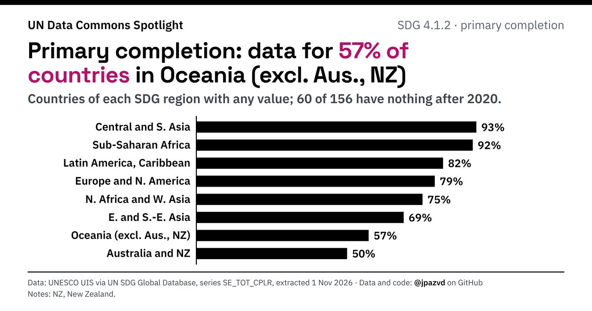

# Spotlight 12-D · School completion, SDG regions compared, by sex

<!-- Written by scripts/build_spotlight_readmes.py from the files in this folder; do not edit. -->

The data behind it · template E dark · [all versions of this topic](../../)

**Primary completion: data for 57% of countries in Oceania (excl. Aus., NZ)**

[Post text and comments](captions.md) · [Every number](stats.json) · [Alt text](alt.txt) · [Design source](banner.dc.html) · [Full-size banner](banner.png)
