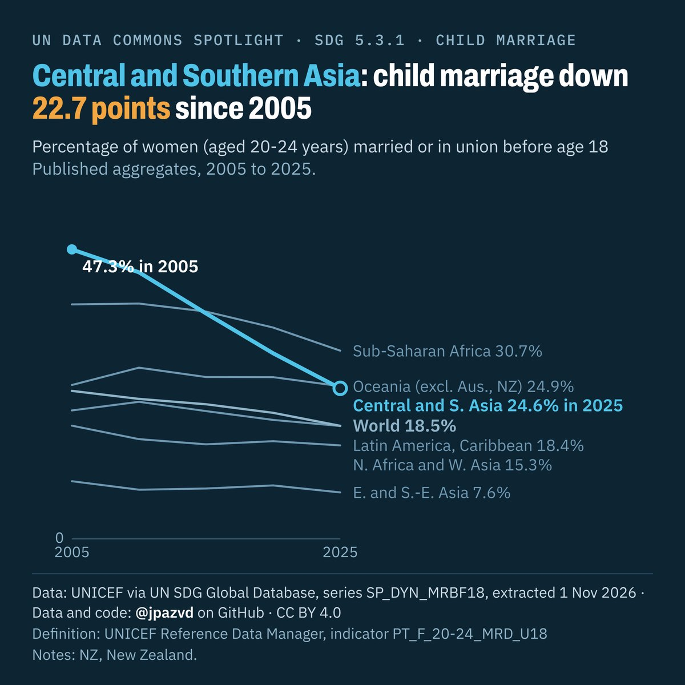

# Spotlight 13-L · Child marriage before 18, SDG regions compared, by location

<!-- Written by scripts/build_spotlight_readmes.py from the files in this folder; do not edit. -->

The long view · template E dark · [all versions of this topic](../../)

**Central and Southern Asia: child marriage down 22.7 points since 2005**

[Post text and comments](captions.md) · [Every number](stats.json) · [Alt text](alt.txt) · [Design source](banner.dc.html) · [Full-size banner](banner.png)
