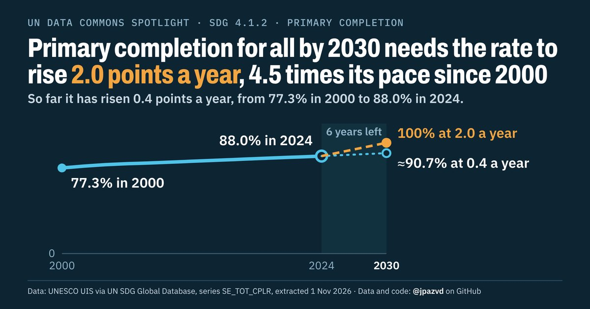

# Spotlight 15-T · School completion, World, by wealth

<!-- Written by scripts/build_spotlight_readmes.py from the files in this folder; do not edit. -->

What it would take · template D dark · [all versions of this topic](../../)

**Primary completion for all by 2030 needs the rate to rise 2.0 points a year, 4.5 times its pace since 2000**

[Post text and comments](captions.md) · [Every number](stats.json) · [Alt text](alt.txt) · [Design source](banner.dc.html) · [Full-size banner](banner.png)
