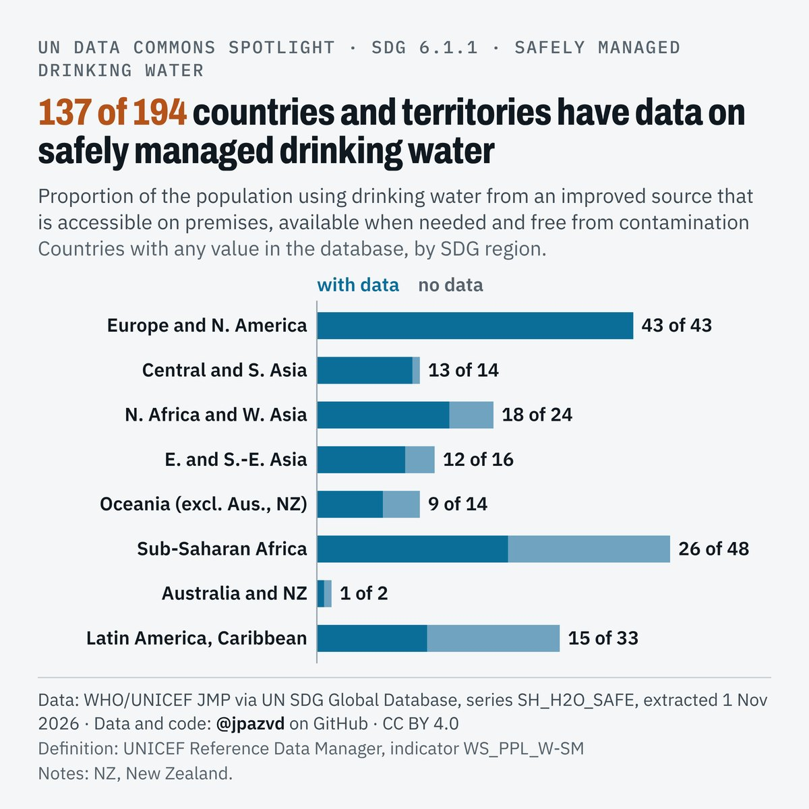

# Spotlight 16-D · Safely managed drinking water, World

<!-- Written by scripts/build_spotlight_readmes.py from the files in this folder; do not edit. -->

The data behind it · template E light · [all versions of this topic](../../)

**137 of 194 countries and territories have data on safely managed drinking water**

[Post text and comments](captions.md) · [Every number](stats.json) · [Alt text](alt.txt) · [Design source](banner.dc.html) · [Full-size banner](banner.png)
