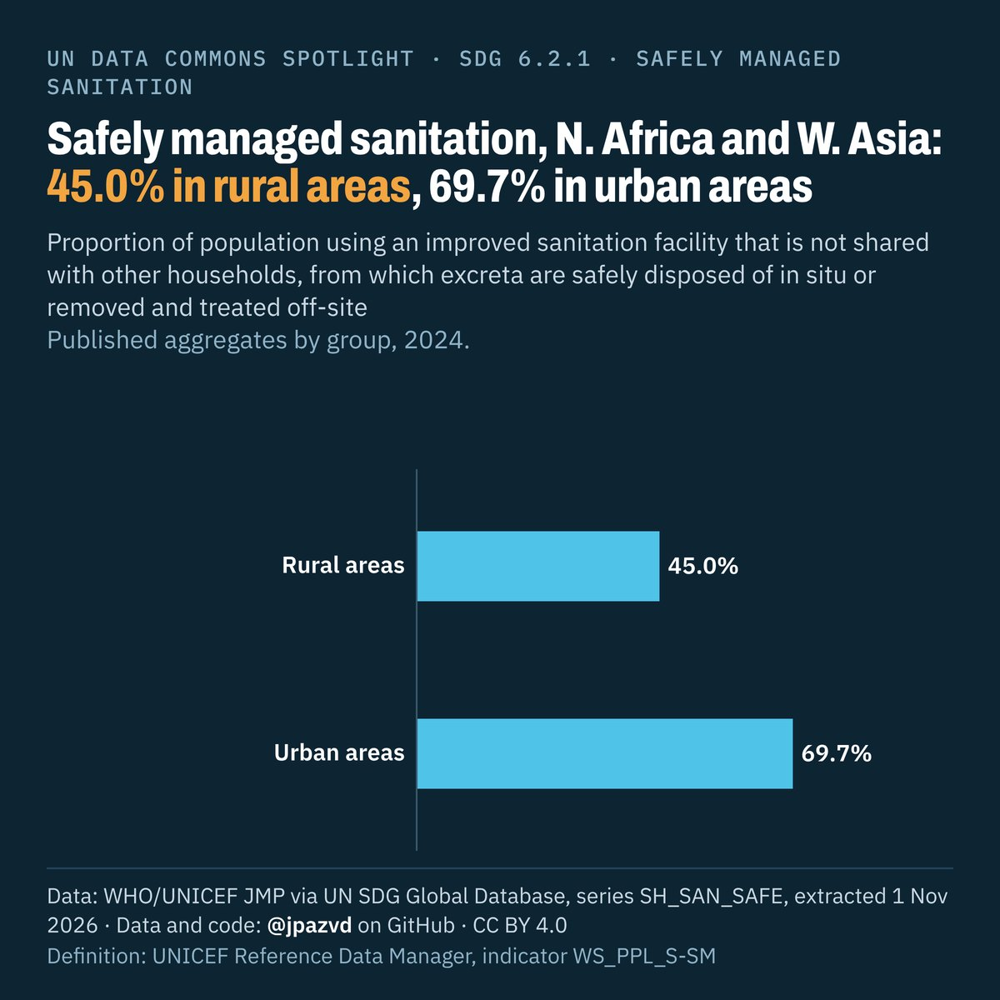

# Spotlight 18-G · Safely managed sanitation, Northern Africa and Western Asia, by location

<!-- Written by scripts/build_spotlight_readmes.py from the files in this folder; do not edit. -->

Behind the average · template E dark · [all versions of this topic](../../)

**Safely managed sanitation, N. Africa and W. Asia: 45.0% in rural areas, 69.7% in urban areas**

[Post text and comments](captions.md) · [Every number](stats.json) · [Alt text](alt.txt) · [Design source](banner.dc.html) · [Full-size banner](banner.png)
