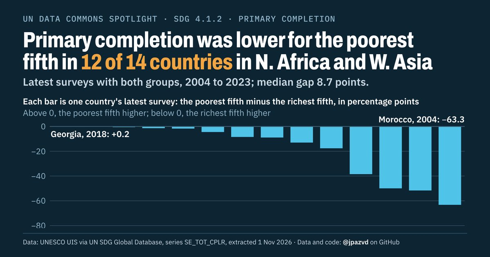

# Spotlight 19-G · School completion, Northern Africa and Western Asia, by wealth

<!-- Written by scripts/build_spotlight_readmes.py from the files in this folder; do not edit. -->

Behind the average · template D dark · [all versions of this topic](../../)

**Primary completion was lower for the poorest fifth in 12 of 14 countries in N. Africa and W. Asia**

[Post text and comments](captions.md) · [Every number](stats.json) · [Alt text](alt.txt) · [Design source](banner.dc.html) · [Full-size banner](banner.png)
