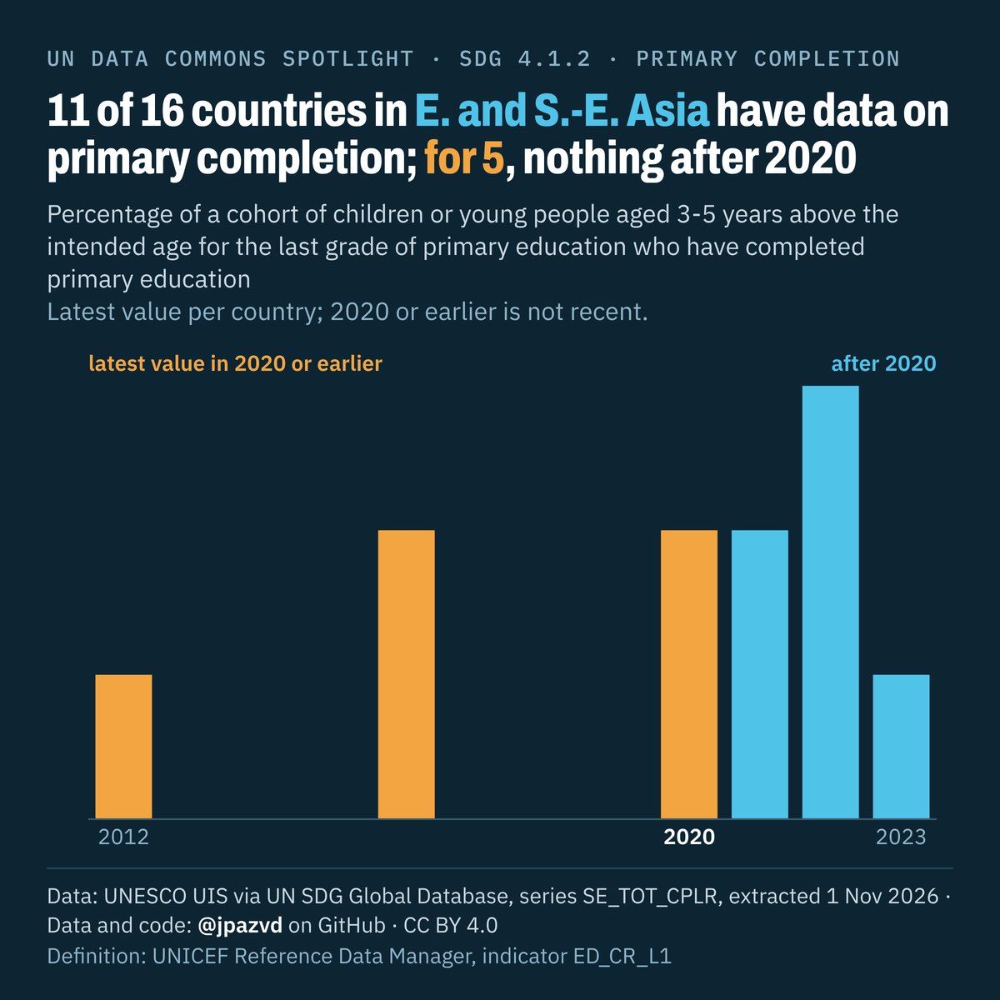

# Spotlight 21-D · School completion, Eastern and South-eastern Asia, by wealth

<!-- Written by scripts/build_spotlight_readmes.py from the files in this folder; do not edit. -->

The data behind it · template E dark · [all versions of this topic](../../)

**11 of 16 countries in E. and S.-E. Asia have data on primary completion; for 5, nothing after 2020**

[Post text and comments](captions.md) · [Every number](stats.json) · [Alt text](alt.txt) · [Design source](banner.dc.html) · [Full-size banner](banner.png)
