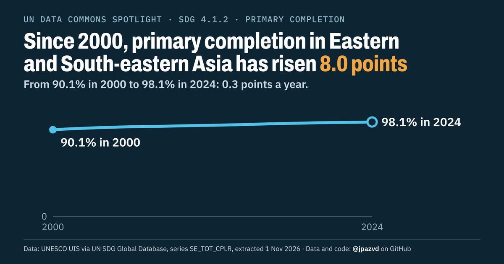

# Spotlight 21-L · School completion, Eastern and South-eastern Asia, by wealth

<!-- Written by scripts/build_spotlight_readmes.py from the files in this folder; do not edit. -->

The long view · template D dark · [all versions of this topic](../../)

**Since 2000, primary completion in Eastern and South-eastern Asia has risen 8.0 points**

[Post text and comments](captions.md) · [Every number](stats.json) · [Alt text](alt.txt) · [Design source](banner.dc.html) · [Full-size banner](banner.png)
