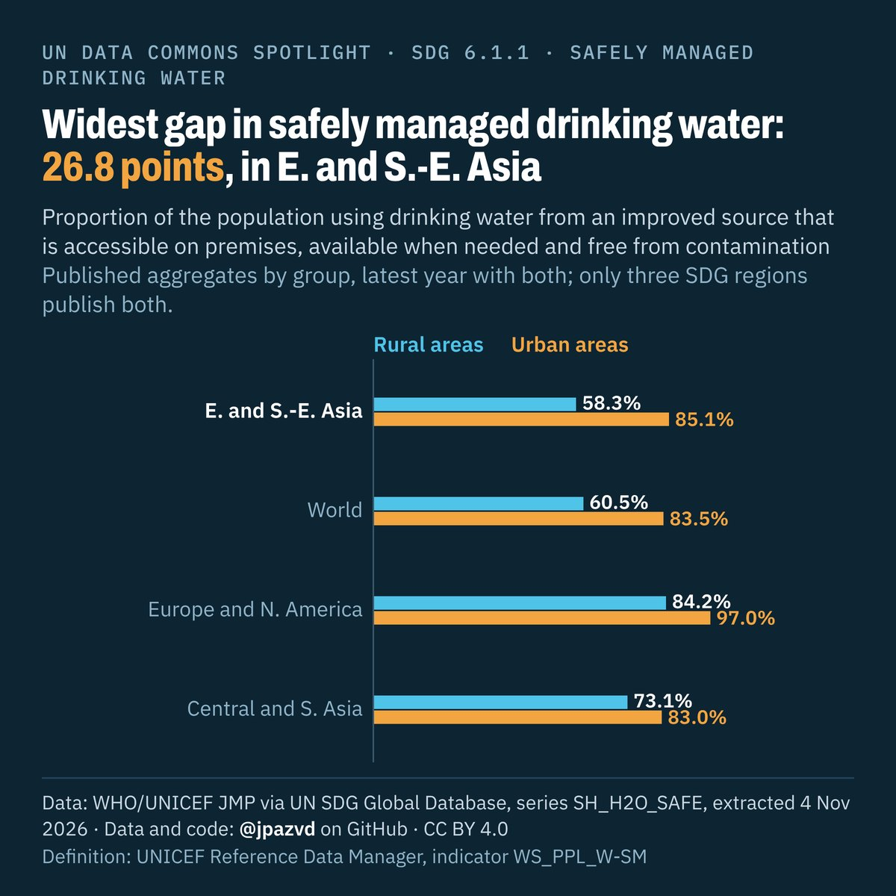

# Spotlight 22 · Safely managed drinking water, rural and urban, SDG regions that publish both

<!-- Written by scripts/build_spotlight_readmes.py from the files in this folder; do not edit. -->

SDG 6.1.1 · data retrieved 2026-11-04

1 version of this topic, each with its own headline framing and banner design.

## G · behind the average · template E dark

**Widest gap in safely managed drinking water: 26.8 points, in E. and S.-E. Asia**

[Post text and comments](versions/G/captions.md) · [Every number](versions/G/stats.json) · [Alt text](versions/G/alt.txt) · [Design source](versions/G/banner.dc.html) · [Full-size banner](versions/G/banner.png)

## Data and calls

- [data/breakdown_aggregates.csv](data/breakdown_aggregates.csv)
- [data/breakdown_countries.csv](data/breakdown_countries.csv)
- [data/countries_latest.csv](data/countries_latest.csv)
- [data/membership.csv](data/membership.csv)
- [data/place_series.csv](data/place_series.csv)
- [data/world.csv](data/world.csv)
- [meta.json](meta.json)
- [retrieval.json](retrieval.json)

Every number re-derives from these files: `python scripts/reproduce.py spotlights/22-water-regions-urban-rural`
