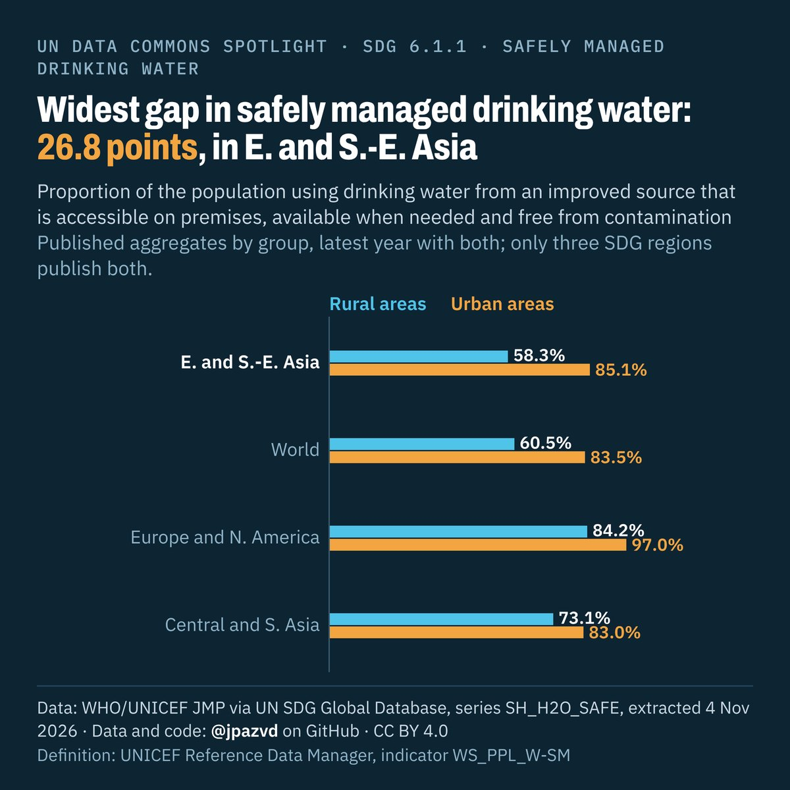

# Spotlight 22-G · Safely managed drinking water, rural and urban, SDG regions that publish both

<!-- Written by scripts/build_spotlight_readmes.py from the files in this folder; do not edit. -->

Behind the average · template E dark · [all versions of this topic](../../)

**Widest gap in safely managed drinking water: 26.8 points, in E. and S.-E. Asia**

[Post text and comments](captions.md) · [Every number](stats.json) · [Alt text](alt.txt) · [Design source](banner.dc.html) · [Full-size banner](banner.png)
