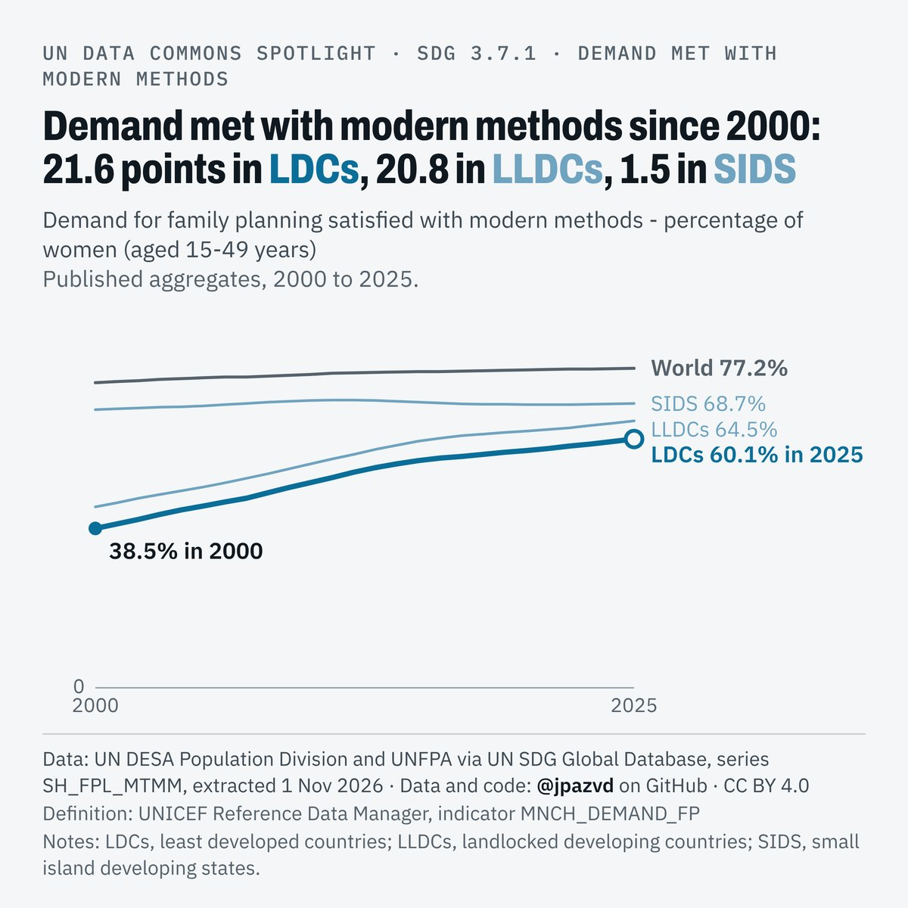
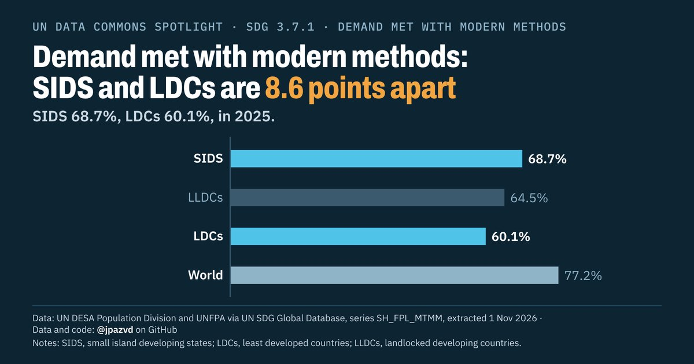
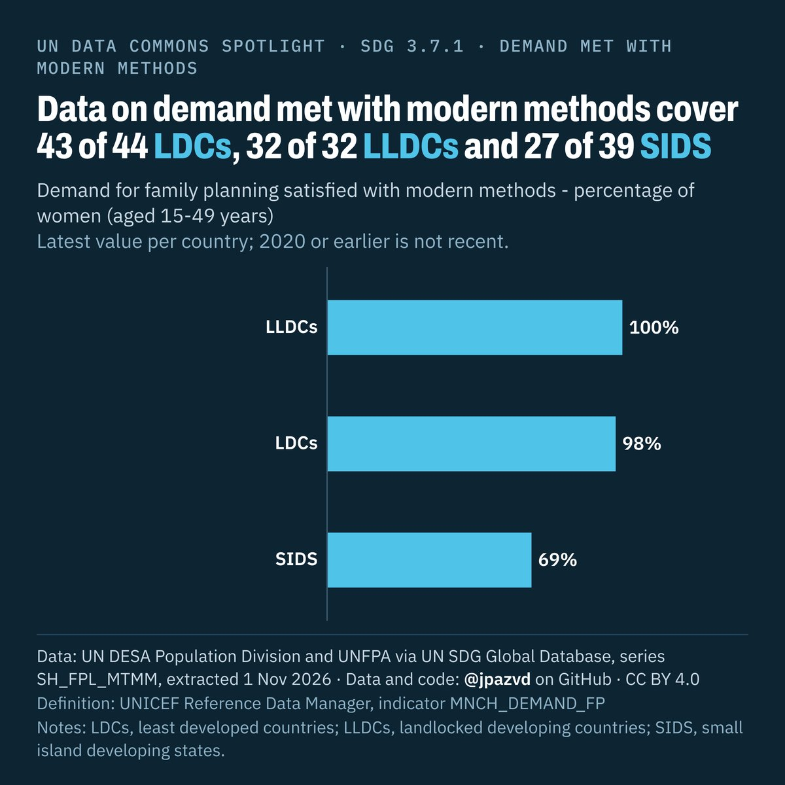

# Spotlight 23 · Family planning demand satisfied (modern methods), LDCs, LLDCs and SIDS compared with the World

<!-- Written by scripts/build_spotlight_readmes.py from the files in this folder; do not edit. -->

SDG 3.7.1 · data retrieved 2026-11-01

3 versions of this topic, each with its own headline framing and banner design.

## L · the long view · template E light

**Demand met with modern methods since 2000: 21.6 points in LDCs, 20.8 in LLDCs, 1.5 in SIDS**

[Post text and comments](versions/L/captions.md) · [Every number](versions/L/stats.json) · [Alt text](versions/L/alt.txt) · [Design source](versions/L/banner.dc.html) · [Full-size banner](versions/L/banner.png)

## G · behind the average · template D dark

**Demand met with modern methods: SIDS and LDCs are 8.6 points apart**

[Post text and comments](versions/G/captions.md) · [Every number](versions/G/stats.json) · [Alt text](versions/G/alt.txt) · [Design source](versions/G/banner.dc.html) · [Full-size banner](versions/G/banner.png)

## D · the data behind it · template E dark

**Data on demand met with modern methods cover 43 of 44 LDCs, 32 of 32 LLDCs and 27 of 39 SIDS**

[Post text and comments](versions/D/captions.md) · [Every number](versions/D/stats.json) · [Alt text](versions/D/alt.txt) · [Design source](versions/D/banner.dc.html) · [Full-size banner](versions/D/banner.png)

## Data and calls

- [data/countries_latest.csv](data/countries_latest.csv)
- [data/membership.csv](data/membership.csv)
- [data/place_series.csv](data/place_series.csv)
- [data/world.csv](data/world.csv)
- [meta.json](meta.json)
- [retrieval.json](retrieval.json)

Every number re-derives from these files: `python scripts/reproduce.py spotlights/23-family-planning-ldc-lldc-sids`
