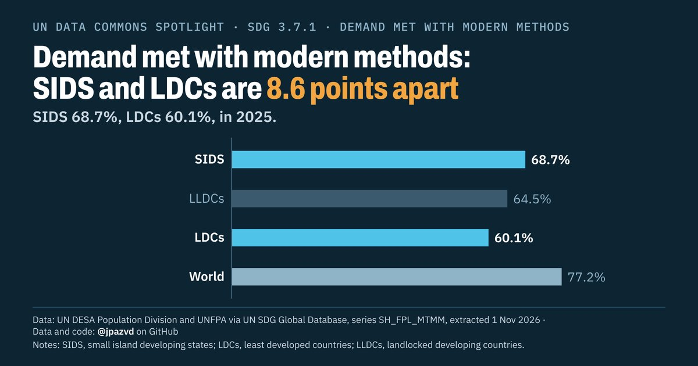

# Spotlight 23-G · Family planning demand satisfied (modern methods), LDCs, LLDCs and SIDS compared with the World

<!-- Written by scripts/build_spotlight_readmes.py from the files in this folder; do not edit. -->

Behind the average · template D dark · [all versions of this topic](../../)

**Demand met with modern methods: SIDS and LDCs are 8.6 points apart**

[Post text and comments](captions.md) · [Every number](stats.json) · [Alt text](alt.txt) · [Design source](banner.dc.html) · [Full-size banner](banner.png)
