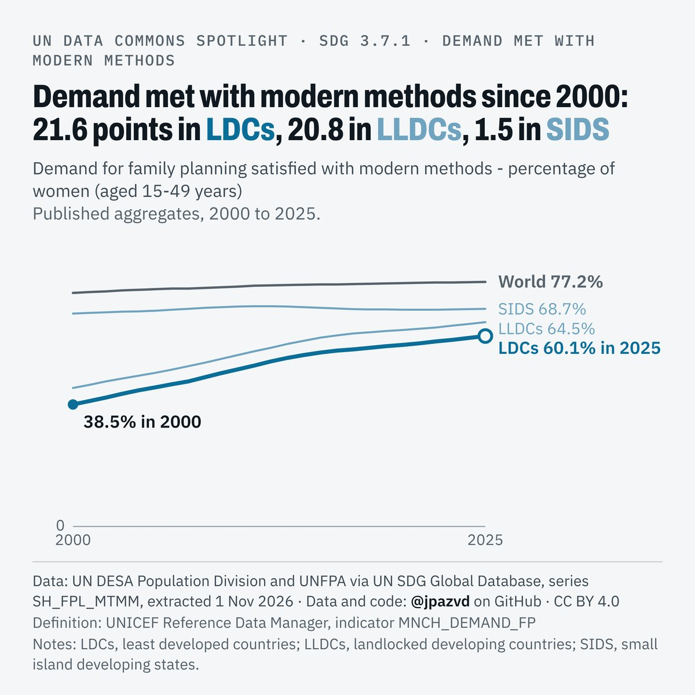

# Spotlight 23-L · Family planning demand satisfied (modern methods), LDCs, LLDCs and SIDS compared with the World

<!-- Written by scripts/build_spotlight_readmes.py from the files in this folder; do not edit. -->

The long view · template E light · [all versions of this topic](../../)

**Demand met with modern methods since 2000: 21.6 points in LDCs, 20.8 in LLDCs, 1.5 in SIDS**

[Post text and comments](captions.md) · [Every number](stats.json) · [Alt text](alt.txt) · [Design source](banner.dc.html) · [Full-size banner](banner.png)
