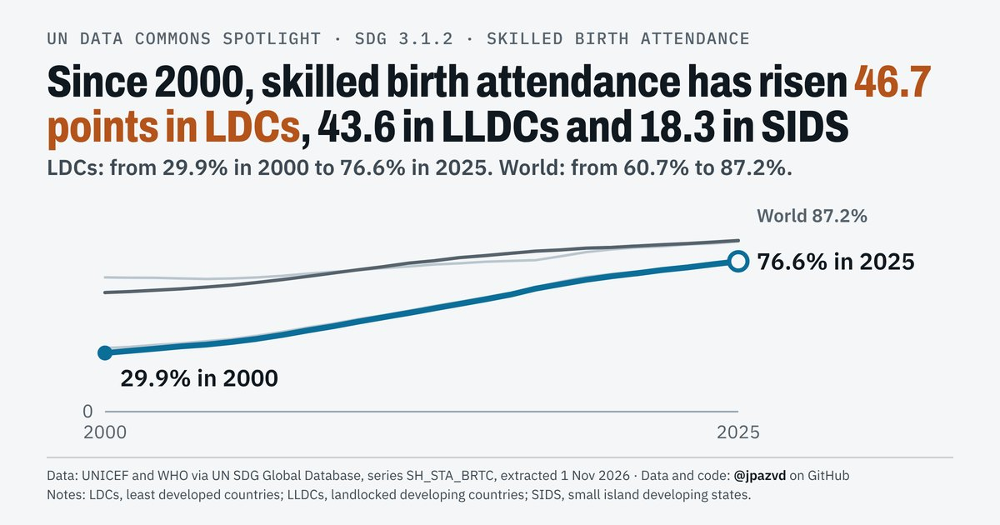

# Spotlight 24-L · Skilled birth attendance, LDCs, LLDCs and SIDS compared with the World, by wealth

<!-- Written by scripts/build_spotlight_readmes.py from the files in this folder; do not edit. -->

The long view · template E light · [all versions of this topic](../../)

**Skilled birth attendance: up 46.7 points in LDCs, 43.6 in LLDCs and 18.3 in SIDS since 2000**

[Post text and comments](captions.md) · [Every number](stats.json) · [Alt text](alt.txt) · [Design source](banner.dc.html) · [Full-size banner](banner.png)
