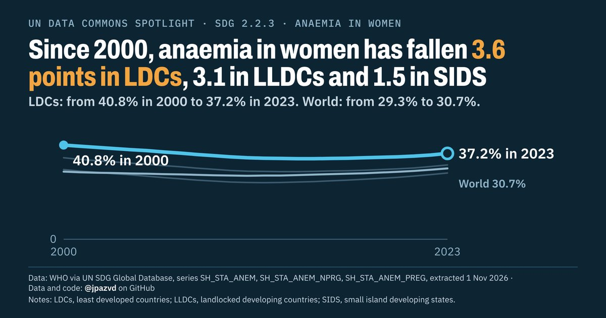

# Spotlight 25-L · Anaemia in women 15-49, LDCs, LLDCs and SIDS compared with the World

<!-- Written by scripts/build_spotlight_readmes.py from the files in this folder; do not edit. -->

The long view · template D dark · [all versions of this topic](../../)

**Since 2000, anaemia in women has fallen 3.6 points in LDCs, 3.1 in LLDCs and 1.5 in SIDS**

[Post text and comments](captions.md) · [Every number](stats.json) · [Alt text](alt.txt) · [Design source](banner.dc.html) · [Full-size banner](banner.png)
