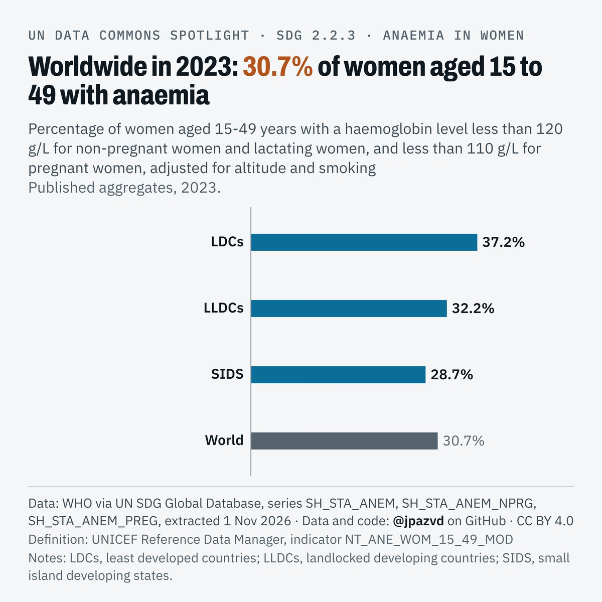

# Spotlight 25-T · Anaemia in women 15-49, LDCs, LLDCs and SIDS compared with the World

<!-- Written by scripts/build_spotlight_readmes.py from the files in this folder; do not edit. -->

What it would take · template E light · [all versions of this topic](../../)

**Worldwide in 2023: 30.7% of women aged 15 to 49 with anaemia**

[Post text and comments](captions.md) · [Every number](stats.json) · [Alt text](alt.txt) · [Design source](banner.dc.html) · [Full-size banner](banner.png)
