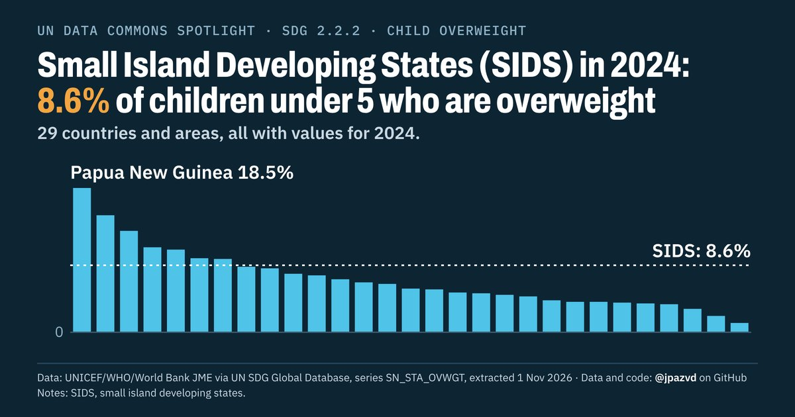

# Spotlight 26-T · Child overweight, Small island developing states (SIDS), by location

<!-- Written by scripts/build_spotlight_readmes.py from the files in this folder; do not edit. -->

What it would take · template D dark · [all versions of this topic](../../)

**Small Island Developing States (SIDS) in 2024: 8.6% of children under 5 who are overweight**

[Post text and comments](captions.md) · [Every number](stats.json) · [Alt text](alt.txt) · [Design source](banner.dc.html) · [Full-size banner](banner.png)
