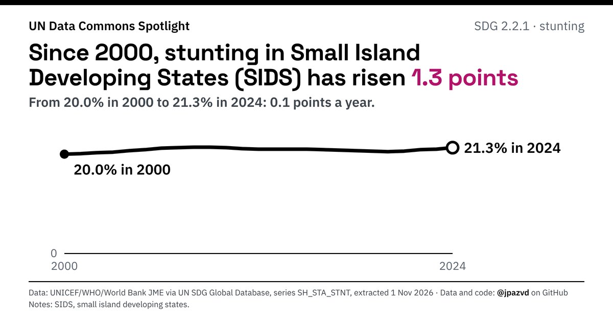

# Spotlight 28-L · Stunting, Small island developing states (SIDS), by location

<!-- Written by scripts/build_spotlight_readmes.py from the files in this folder; do not edit. -->

The long view · template E dark · [all versions of this topic](../../)

**Since 2000, stunting in Small Island Developing States (SIDS) has risen 1.3 points**

[Post text and comments](captions.md) · [Every number](stats.json) · [Alt text](alt.txt) · [Design source](banner.dc.html) · [Full-size banner](banner.png)
