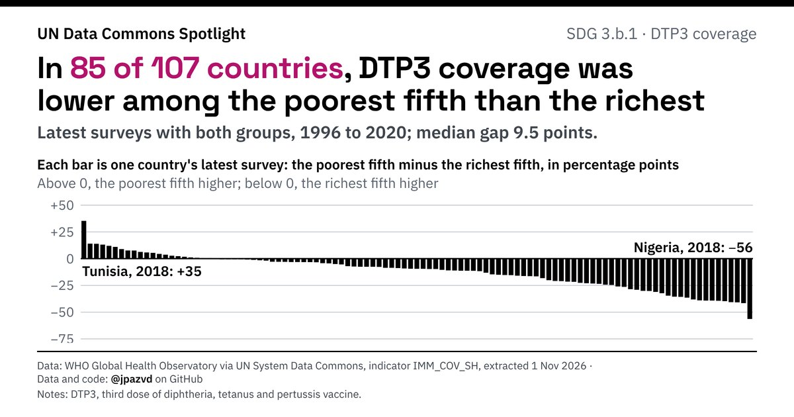

# Spotlight 30-G · DTP3 immunization, SDG regions compared, by wealth

<!-- Written by scripts/build_spotlight_readmes.py from the files in this folder; do not edit. -->

Behind the average · template E dark · [all versions of this topic](../../)

**In 85 of 107 countries, DTP3 coverage was lower among the poorest fifth than the richest**

[Post text and comments](captions.md) · [Every number](stats.json) · [Alt text](alt.txt) · [Design source](banner.dc.html) · [Full-size banner](banner.png)
