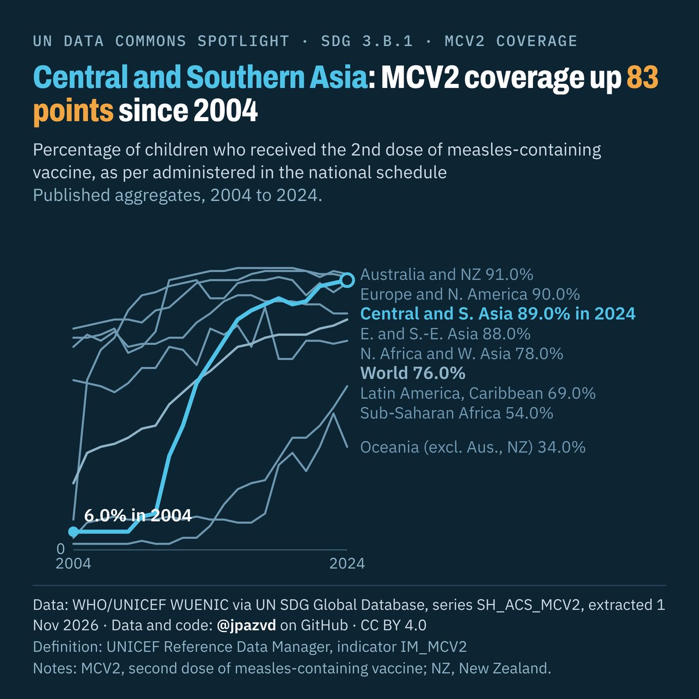

# Spotlight 32-L · MCV2 immunization, SDG regions compared

<!-- Written by scripts/build_spotlight_readmes.py from the files in this folder; do not edit. -->

The long view · template E dark · [all versions of this topic](../../)

**Central and Southern Asia: MCV2 coverage up 83 points since 2004**

[Post text and comments](captions.md) · [Every number](stats.json) · [Alt text](alt.txt) · [Design source](banner.dc.html) · [Full-size banner](banner.png)
