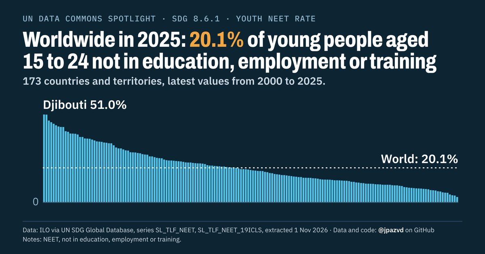

# Spotlight 34-T · Youth NEET, World, by sex

<!-- Written by scripts/build_spotlight_readmes.py from the files in this folder; do not edit. -->

What it would take · template D dark · [all versions of this topic](../../)

**Worldwide in 2025: 20.1% of young people aged 15 to 24 not in education, employment or training**

[Post text and comments](captions.md) · [Every number](stats.json) · [Alt text](alt.txt) · [Design source](banner.dc.html) · [Full-size banner](banner.png)
