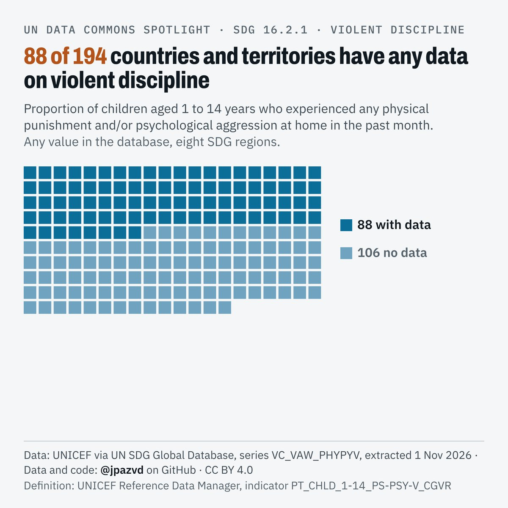
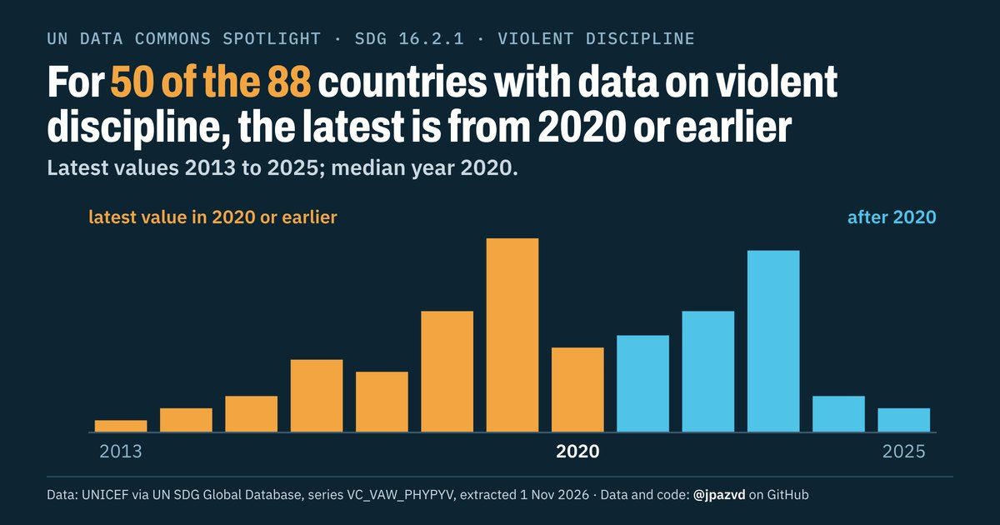
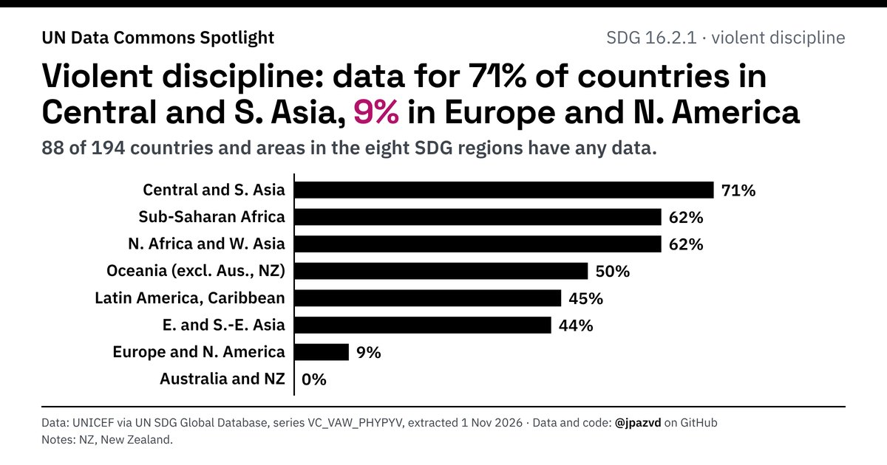

# Spotlight 36 · Violent discipline, World

<!-- Written by scripts/build_spotlight_readmes.py from the files in this folder; do not edit. -->

SDG 16.2.1 · data retrieved 2026-11-01

3 versions of this topic, each with its own headline framing and banner design.

## D1 · the data behind it (1 of 3) · template E light

**88 of 194 countries and territories have any data on violent discipline**

[Post text and comments](versions/D1/captions.md) · [Every number](versions/D1/stats.json) · [Alt text](versions/D1/alt.txt) · [Design source](versions/D1/banner.dc.html) · [Full-size banner](versions/D1/banner.png)

## D2 · the data behind it (2 of 3) · template D dark

**For 50 of the 88 countries with data on violent discipline, the latest is from 2020 or earlier**

[Post text and comments](versions/D2/captions.md) · [Every number](versions/D2/stats.json) · [Alt text](versions/D2/alt.txt) · [Design source](versions/D2/banner.dc.html) · [Full-size banner](versions/D2/banner.png)

## D3 · the data behind it (3 of 3) · template E dark

**Violent discipline: data for 71% of countries in Central and S. Asia, 9% in Europe and N. America**

[Post text and comments](versions/D3/captions.md) · [Every number](versions/D3/stats.json) · [Alt text](versions/D3/alt.txt) · [Design source](versions/D3/banner.dc.html) · [Full-size banner](versions/D3/banner.png)

## Data and calls

- [data/countries_latest.csv](data/countries_latest.csv)
- [data/membership.csv](data/membership.csv)
- [data/place_series.csv](data/place_series.csv)
- [data/world.csv](data/world.csv)
- [meta.json](meta.json)
- [retrieval.json](retrieval.json)

Every number re-derives from these files: `python scripts/reproduce.py spotlights/36-violent-discipline-world`
