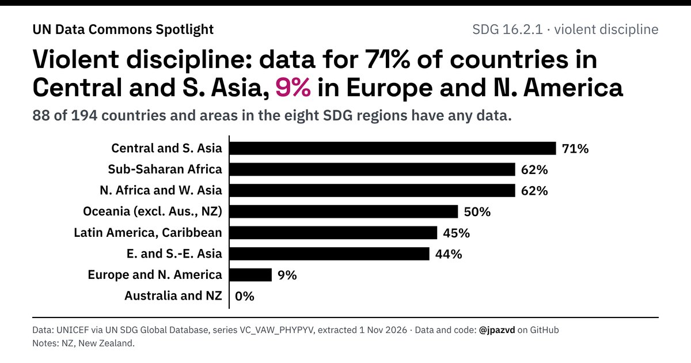

# Spotlight 36-D3 · Violent discipline, World

<!-- Written by scripts/build_spotlight_readmes.py from the files in this folder; do not edit. -->

The data behind it (3 of 3) · template E dark · [all versions of this topic](../../)

**Violent discipline: data for 71% of countries in Central and S. Asia, 9% in Europe and N. America**

[Post text and comments](captions.md) · [Every number](stats.json) · [Alt text](alt.txt) · [Design source](banner.dc.html) · [Full-size banner](banner.png)
