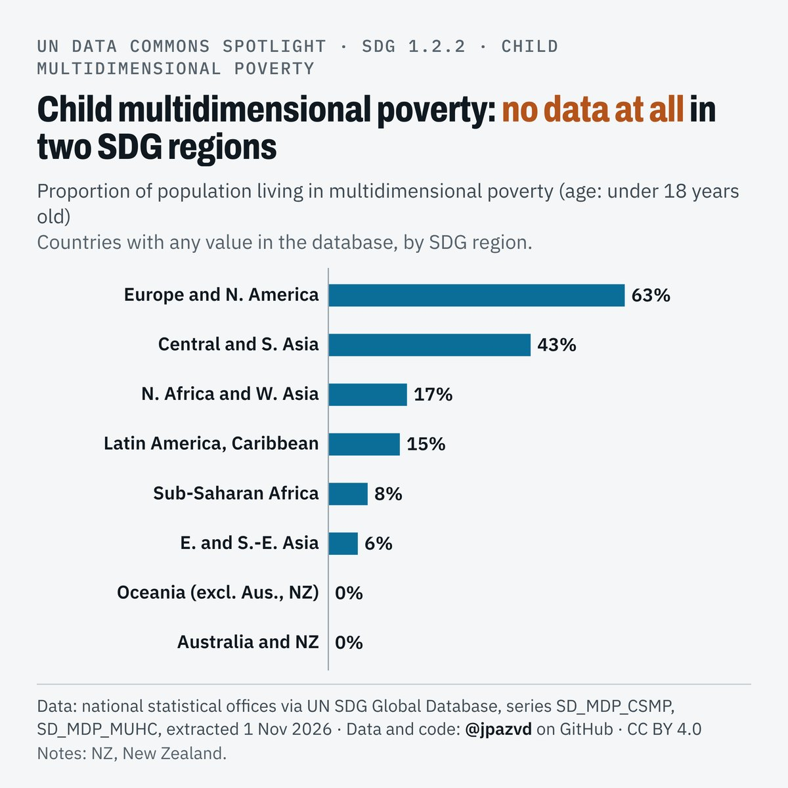

# Spotlight 37-D3 · Child multidimensional poverty, World

<!-- Written by scripts/build_spotlight_readmes.py from the files in this folder; do not edit. -->

The data behind it (3 of 3) · template E light · [all versions of this topic](../../)

**Child multidimensional poverty: no data at all in two SDG regions**

[Post text and comments](captions.md) · [Every number](stats.json) · [Alt text](alt.txt) · [Design source](banner.dc.html) · [Full-size banner](banner.png)
