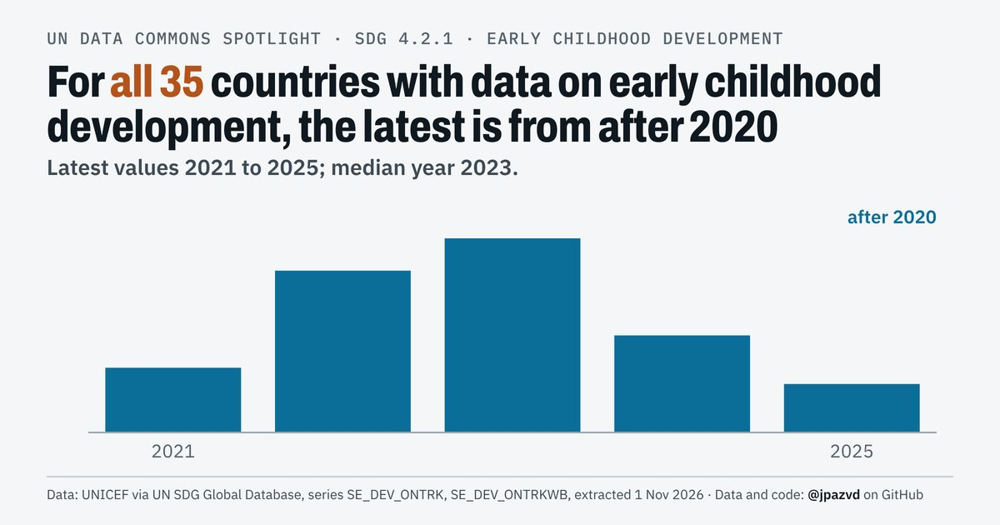

# Spotlight 38-D2 · Early childhood development, World

<!-- Written by scripts/build_spotlight_readmes.py from the files in this folder; do not edit. -->

The data behind it (2 of 3) · template E light · [all versions of this topic](../../)

**For all 35 countries with data on early childhood development, the latest is from after 2020**

[Post text and comments](captions.md) · [Every number](stats.json) · [Alt text](alt.txt) · [Design source](banner.dc.html) · [Full-size banner](banner.png)
