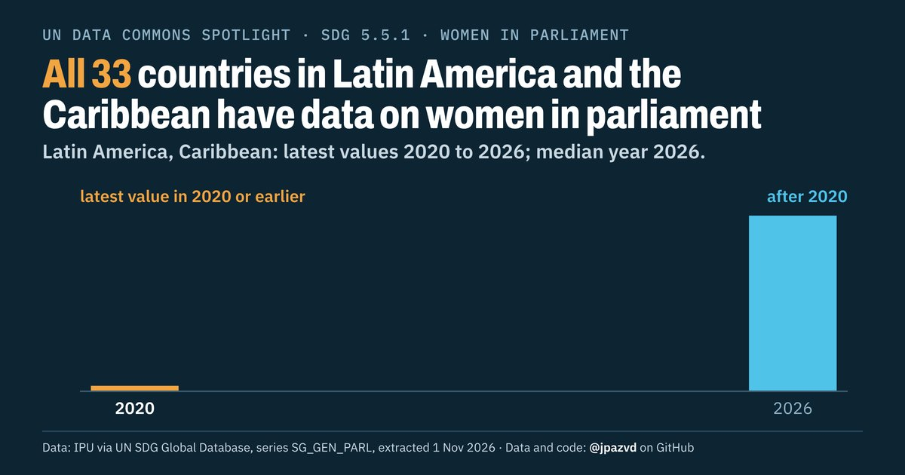

# Spotlight 39-D · Women in national parliaments, Latin America and the Caribbean

<!-- Written by scripts/build_spotlight_readmes.py from the files in this folder; do not edit. -->

The data behind it · template D dark · [all versions of this topic](../../)

**All 33 countries in Latin America and the Caribbean have data on women in parliament**

[Post text and comments](captions.md) · [Every number](stats.json) · [Alt text](alt.txt) · [Design source](banner.dc.html) · [Full-size banner](banner.png)
