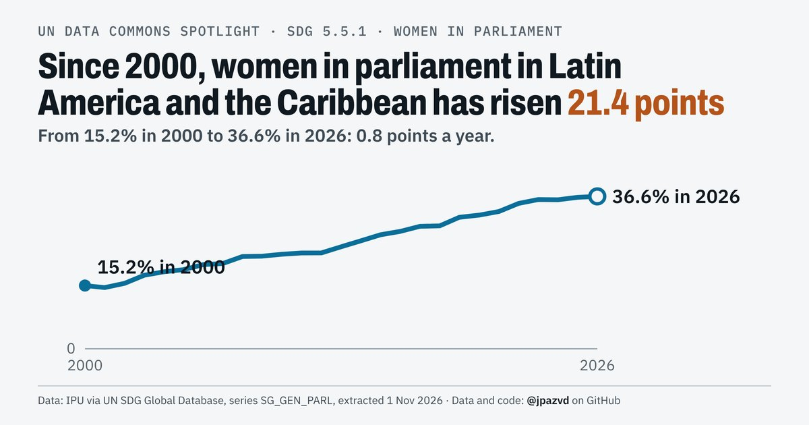

# Spotlight 39-L · Women in national parliaments, Latin America and the Caribbean

<!-- Written by scripts/build_spotlight_readmes.py from the files in this folder; do not edit. -->

The long view · template E light · [all versions of this topic](../../)

**Women in parliament, Latin America and the Caribbean: up 21.4 points since 2000**

[Post text and comments](captions.md) · [Every number](stats.json) · [Alt text](alt.txt) · [Design source](banner.dc.html) · [Full-size banner](banner.png)
