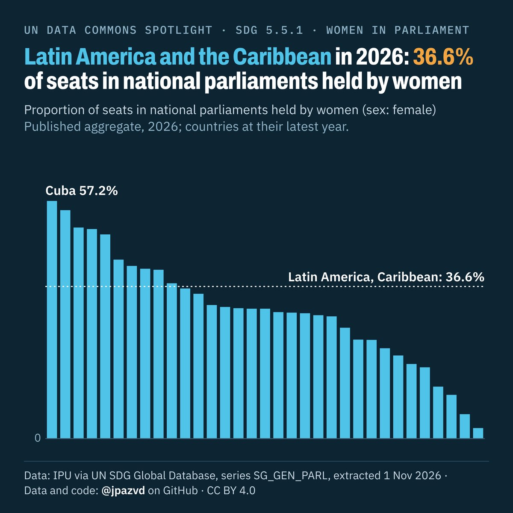

# Spotlight 39-T · Women in national parliaments, Latin America and the Caribbean

<!-- Written by scripts/build_spotlight_readmes.py from the files in this folder; do not edit. -->

What it would take · template E dark · [all versions of this topic](../../)

**Latin America and the Caribbean in 2026: 36.6% of seats in national parliaments held by women**

[Post text and comments](captions.md) · [Every number](stats.json) · [Alt text](alt.txt) · [Design source](banner.dc.html) · [Full-size banner](banner.png)
