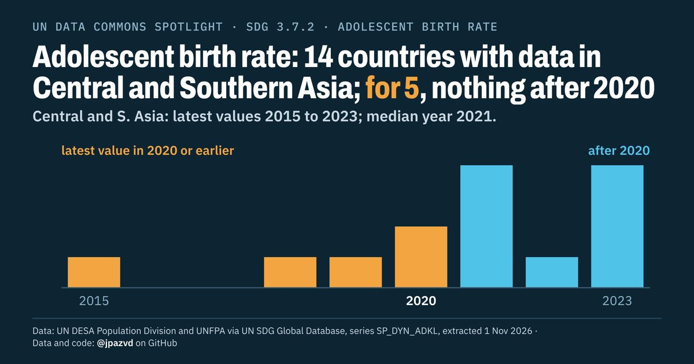

# Spotlight 40-D · Adolescent birth rate, Central and Southern Asia, by location

<!-- Written by scripts/build_spotlight_readmes.py from the files in this folder; do not edit. -->

The data behind it · template D dark · [all versions of this topic](../../)

**Adolescent birth rate: 14 countries with data in Central and Southern Asia; for 5, nothing after 2020**

[Post text and comments](captions.md) · [Every number](stats.json) · [Alt text](alt.txt) · [Design source](banner.dc.html) · [Full-size banner](banner.png)
