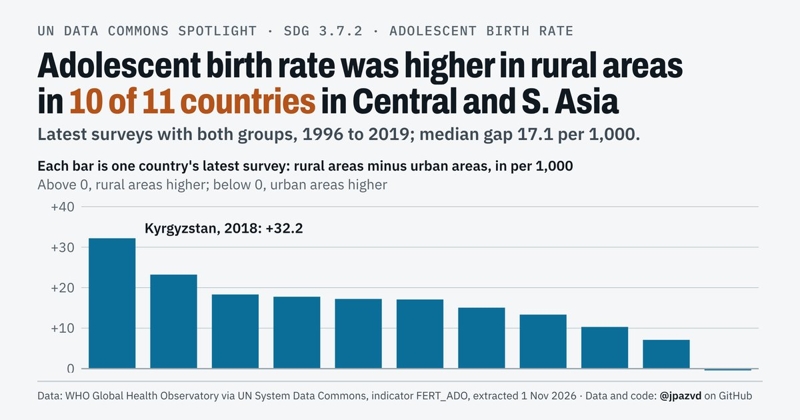

# Spotlight 40-G · Adolescent birth rate, Central and Southern Asia, by location

<!-- Written by scripts/build_spotlight_readmes.py from the files in this folder; do not edit. -->

Behind the average · template E light · [all versions of this topic](../../)

**Adolescent birth rate was higher in rural areas in 10 of 11 countries in Central and S. Asia**

[Post text and comments](captions.md) · [Every number](stats.json) · [Alt text](alt.txt) · [Design source](banner.dc.html) · [Full-size banner](banner.png)
