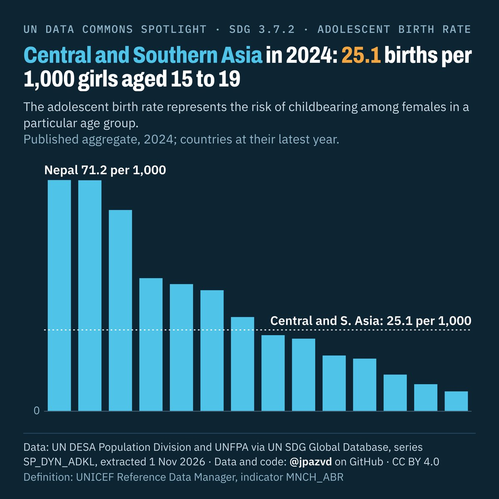

# Spotlight 40-T · Adolescent birth rate, Central and Southern Asia, by location

<!-- Written by scripts/build_spotlight_readmes.py from the files in this folder; do not edit. -->

What it would take · template E dark · [all versions of this topic](../../)

**Central and Southern Asia in 2024: 25.1 births per 1,000 girls aged 15 to 19**

[Post text and comments](captions.md) · [Every number](stats.json) · [Alt text](alt.txt) · [Design source](banner.dc.html) · [Full-size banner](banner.png)
